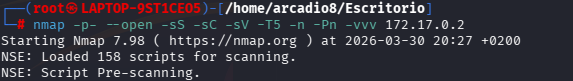
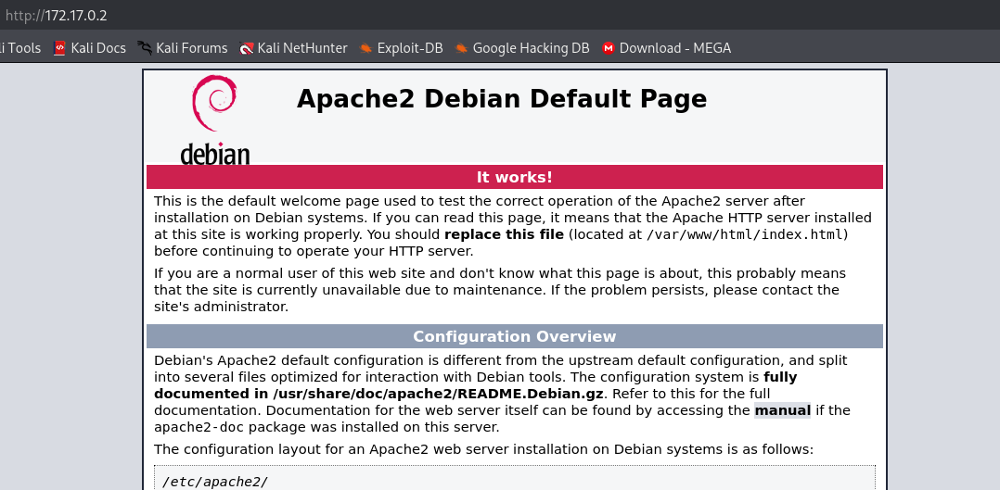
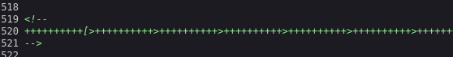
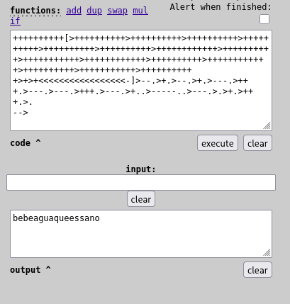
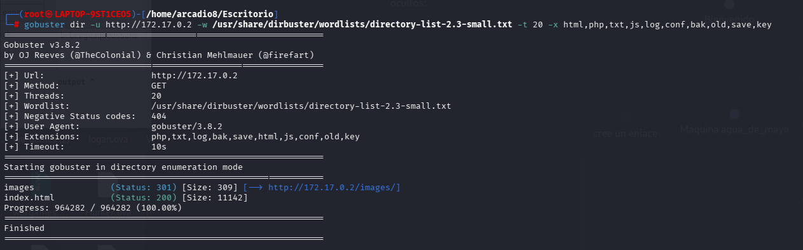
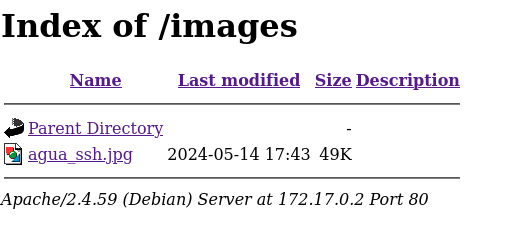

# 🛡️ Writeup — Máquina "Agua de Mayo"

**IP objetivo:** `172.17.0.2`
**Servicios expuestos:** `22 (SSH)`, `80 (HTTP)`

---

## 📌 Resumen Ejecutivo

> [!NOTE]
> Reconocimiento y enumeración web hasta la obtención de una credencial válida oculta mediante código Brainfuck embebido en la web. **Esta nota queda incompleta** — no se documenta el uso de la credencial obtenida para lograr acceso ni escalada de privilegios.

---

## 🔍 1. Reconocimiento

```bash
# Despliegue del laboratorio
bash auto_deploy.sh agua_de_mayo.tar
```


```bash
nmap -p- --open -sS -sC -sV -T4 -n -vvv -Pn 172.17.0.2
```



Puertos 22 y 80 abiertos.

### Enumeración web
```bash
whatweb http://172.17.0.2
```


Sin nada interesante a primera vista, se revisa el código fuente en busca de pistas:



---

## 🚩 Hallazgos

### 🟡 H1: Exposición de credenciales mediante código Brainfuck embebido

**Severidad:** Media

**Resumen:** El código fuente de la web contiene un fragmento en Brainfuck (lenguaje de programación esotérico), que al decodificarse revela una contraseña válida del sistema.

**Detalle / PoC**

El fragmento extraño del código fuente se identifica como Brainfuck. Usando un intérprete online se decodifica el mensaje:



Palabra encontrada: `bebeaguaqueessano`

Continuando la enumeración del puerto 80 con `gobuster`:
```bash
gobuster dir -u http://172.17.0.2 -w ...
```


Se encuentra el directorio `images`:


Un recurso `agua_ssh` sugiere que `agua` podría ser un nombre de usuario válido:

```
usuario: agua
contraseña: bebeaguaqueessano
```

**Impacto:** Credencial de sistema potencialmente válida obtenida sin autenticación previa.

**Recomendación:** No embeber credenciales en el código fuente bajo ninguna forma de ofuscación (Brainfuck, Base64, ROT13, etc.) — la ofuscación no es cifrado.

---

## 🔗 Cadena de ataque (parcial)

```text
Enumeración web → código fuente ofuscado (Brainfuck) → credencial "agua:bebeaguaqueessano"
→ [pendiente: verificar acceso SSH y escalada de privilegios]
```

---

## 🛡️ Recomendaciones generales

- No embeber credenciales en código fuente, ni siquiera ofuscadas.
- Auditar el código fuente servido al cliente en busca de comentarios o cadenas sospechosas.

---

## 🧾 Conclusión

> [!NOTE]
> Nota incompleta. Queda pendiente verificar si la credencial `agua`/`bebeaguaqueessano` permite acceso SSH y documentar la fase de escalada de privilegios hasta compromiso total.
